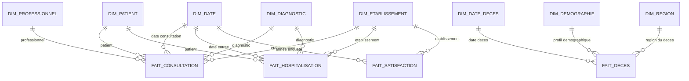
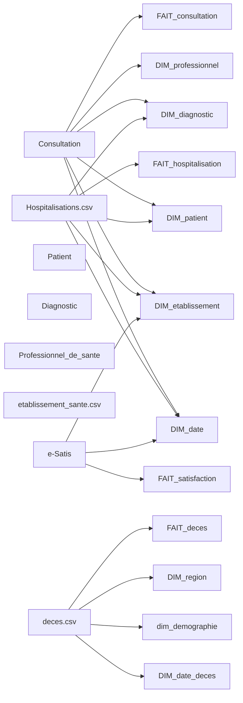

# MCD — Constellation (4 tables de faits)

Architecture en **Constellation** comportant quatre tables de faits distinctes (`FAIT_consultation`, `FAIT_hospitalisation`, `FAIT_satisfaction`, `FAIT_deces`) partageant un ensemble de dimensions communes (*Conformed Dimensions*). Aucune table de faits ne pointe directement vers une autre.

| Étoile / Domaine | Fait | Grain | Dimensions rattachées |
|---|---|---|---|
| Consultations | `FAIT_consultation` | une consultation | `DIM_date`, `DIM_patient`, `DIM_professionnel`, `DIM_diagnostic`, `DIM_etablissement` |
| Hospitalisations | `FAIT_hospitalisation` | un séjour hospitalier | `DIM_date`, `DIM_patient`, `DIM_diagnostic`, `DIM_etablissement` |
| Satisfaction | `FAIT_satisfaction` | un établissement, une année | `DIM_date`, `DIM_etablissement` |
| Décès | `FAIT_deces` | un décès enregistré | `DIM_date_deces`, `dim_demographie`, `DIM_region` |

---

## 1. Schéma Global des Étoiles (Diagramme Mermaid)

---

## 2. Description des Tables de Faits

### FAIT_consultation

Le grain est un acte de consultation unique.

| Attribut | Sens | Clé |
|---|---|---|
| id_consultation | clé primaire / identifiant de consultation | PK |
| duree_min | durée de la consultation en minutes | |
| nb_consultations | valeur fixe 1 | |
| id_date | date de l'acte | FK DIM_date |
| id_patient | patient | FK DIM_patient |
| id_professionnel | professionnel ayant réalisé l'acte | FK DIM_professionnel |
| code_diag | diagnostic associé | FK DIM_diagnostic |
| id_etablissement | site / établissement de consultation | FK DIM_etablissement |

### FAIT_hospitalisation

Le grain est un séjour hospitalier.

| Attribut | Sens | Clé |
|---|---|---|
| id_hospitalisation | clé primaire / identifiant du séjour | PK |
| jours_hospitalisations | durée du séjour en jours | |
| nb_hospitalisations | valeur fixe 1 | |
| id_date | date d'entrée de l'hospitalisation | FK DIM_date |
| id_patient | patient | FK DIM_patient |
| code_diag | diagnostic principal ou suite consultation | FK DIM_diagnostic |
| id_etablissement | site / établissement d'accueil | FK DIM_etablissement |

### FAIT_satisfaction

Le grain est l'évaluation annuelle de la satisfaction d'un établissement.

| Attribut | Sens | Clé |
|---|---|---|
| id_satisfaction | clé primaire | PK |
| nb_reponses | nombre de réponses collectées | |
| score_global | note globale de satisfaction ajustée | |
| id_date | 1er janvier de l'année de l'enquête | FK DIM_date |
| id_etablissement | établissement évalué | FK DIM_etablissement |

### FAIT_deces

Le grain est un décès recensé.

| Attribut | Sens | Clé |
|---|---|---|
| id_deces | clé primaire technique | PK |
| numero_acte_deces | identifiant / numéro d'acte source | |
| id_date_deces | date du décès | FK DIM_date_deces |
| id_demographie | profil démographique (sexe, tranche d'âge) | FK dim_demographie |
| code_lieu_deces | code commune / région du lieu de décès | FK DIM_region |

---

## 3. Description des Dimensions Partagées et Spécifiques

### DIM_date
Dimension temporelle globale partagée par les consultations, hospitalisations et la satisfaction.

| Attribut | Sens | Clé |
|---|---|---|
| id_date | clé technique date (format YYYYMMDD) | PK |
| date_complete | date calendaire complète | |
| jour | jour (1 à 31) | |
| mois | mois (1 à 12) | |
| trimsetre | trimestre (1 à 4) | |
| annee | année civile | |

### DIM_patient
Dimension d'anonymisation et de profil du patient.

| Attribut | Sens | Clé |
|---|---|---|
| id_patient | clé technique / identifiant anonymisé | PK |
| sexe | sexe du patient | |
| annee_naissance | année de naissance | |
| tranche_age | tranche d'âge calculée | |
| code_postal | code postal de résidence | |

### DIM_professionnel
Annuaire des professionnels de santé.

| Attribut | Sens | Clé |
|---|---|---|
| id_professionnel | clé technique | PK |
| identifiant | identifiant RPPS / ADELI | |
| civilite | civilité | |
| nom | nom d'exercice | |
| prenom | prénom d'exercice | |
| categorie_professionnelle | catégorie socio-professionnelle | |
| commune | commune d'exercice | |
| profession | libellé de la profession | |
| specialite | libellé de la spécialité | |
| type_identifiant | type de code identifiant | |

### DIM_diagnostic
Référentiel des codes diagnostics.

| Attribut | Sens | Clé |
|---|---|---|
| code_diag | code diagnostic de référence | PK |
| diagnostic | libellé complet du diagnostic | |

### DIM_etablissement
Référentiel détaillé des structures et sites de santé.

| Attribut | Sens | Clé |
|---|---|---|
| id_etablissement | clé technique | PK |
| nom | nom usuel du site | |
| commune | commune d'implantation | |
| pays | pays | |
| telephone | téléphone principal | |
| region | région | |
| email | courriel de contact | |
| adresse | adresse postale | |
| code_postal | code postal | |
| cedex | cedex | |
| code_commune | code commune INSEE | |
| coomplement_destinataire | complément destinataire | |
| complement_point_geographique | complément géographique | |
| enseigne_commerciale_site | enseigne commerciale | |
| finess_etablissement_juridique | FINESS juridique | |
| finess_site | FINESS géographique / site | |
| identifiant_organisation | identifiant d'organisation | |
| indice_repetition_voie | indice de répétition | |
| mention_distribution | mention de distribution | |
| numero_voie | numéro dans la voie | |
| raison_sociale_site | raison sociale officielle | |
| siren_site | SIREN | |
| siret_site | SIRET | |
| telecopie | télécopie | |
| telephone_2 | téléphone secondaire | |
| type_voie | type de voie | |
| voie | libellé de la voie | |

### DIM_date_deces
Dimension temporelle spécifique aux décès.

| Attribut | Sens | Clé |
|---|---|---|
| id_date_deces | clé technique | PK |
| date_deces | date calendaire du décès | |

### dim_demographie
Dimension synthétique de profil démographique.

| Attribut | Sens | Clé |
|---|---|---|
| id_demographie | clé technique | PK |
| sexe | sexe (`M` / `F`) | |
| tranche_age | tranche d'âge | |

### DIM_region
Référentiel géographique pour les décès.

| Attribut | Sens | Clé |
|---|---|---|
| code_lieu_deces | code lieu / commune du décès | PK |
| departement | département calculé | |
| region | région administrative | |

---

## 4. Flux ETL (Alimentation des Faits et Dimensions)

### Mapping Source → Destination

| Provenance | Colonne Source | Attribut Destination | Remarques / Transformation |
|---|---|---|---|
| Consultation | Date | DIM_date.date_complete | Extraction jour, mois, trimestre, annee |
| Consultation | Num_consultation | FAIT_consultation.id_consultation | Clé primaire |
| Consultation | Heure_debut, Heure_fin | FAIT_consultation.duree_min | Différence Heure_fin - Heure_debut |
| Hospitalisations.csv | Num_Hospitalisation | FAIT_hospitalisation.id_hospitalisation | Clé primaire |
| Hospitalisations.csv | Jour_Hospitalisation | FAIT_hospitalisation.jours_hospitalisations | Durée en jours |
| Patient | Id_patient | DIM_patient.id_patient | Anonymisation de la clé |
| Patient | Sexe | DIM_patient.sexe | Repris |
| Patient | Date | DIM_patient.annee_naissance | Extraction de l'année |
| Patient | Age | DIM_patient.tranche_age | Calcul de la tranche d'âge |
| Diagnostic | Code_diag | DIM_diagnostic.code_diag | Clé primaire |
| Diagnostic | Diagnostic | DIM_diagnostic.diagnostic | Libellé |
| Professionnel_de_sante | Identifiant | DIM_professionnel.identifiant | Repris |
| etablissement_sante.csv | identifiant_organisation | DIM_etablissement.identifiant_organisation | Clé d'organisation |
| e-Satis | score_all_* | FAIT_satisfaction.score_global | Score de satisfaction globale |
| deces.csv | date_deces | DIM_date_deces.date_deces | Repris |
| deces.csv | code_lieu_deces | DIM_region.code_lieu_deces | Mapping département / région |