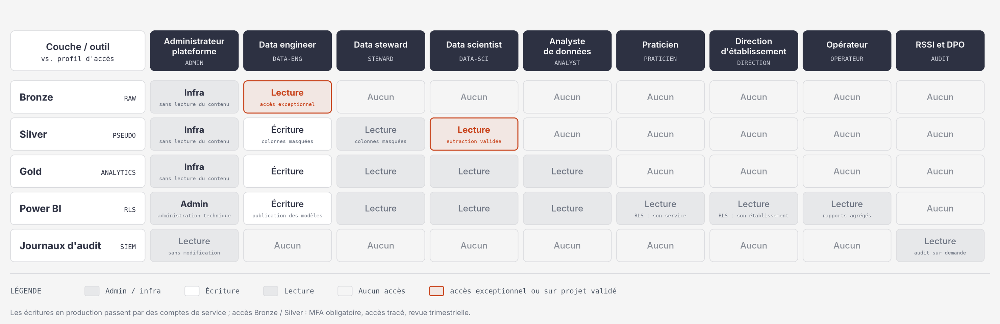

# Plan de gouvernance des données

## 1. Principes et périmètre de la gouvernance

La gouvernance garantit que l'entrepôt de données décisionnel (EDD) du groupe CHU produit des indicateurs fiables tout en traitant des données de santé dans le respect du RGPD, de la loi Informatique et Libertés et du cadre HDS. Elle couvre toute la vie de la donnée, de son arrivée en couche Bronze jusqu'à sa restitution dans Power BI.

### 1.1 Périmètre

| Source | Nature | Données personnelles | Couche d'entrée |
| --- | --- | --- | --- |
| 1. PostgreSQL opérationnelle | Admissions, consultations, diagnostics, séjours | Oui, données de santé (art. 9 RGPD) | Bronze (accès très restreint) |
| 2. CSV établissements (FINESS / INSEE) | Référentiel : capacités, certifications, localisation | Non | Bronze |
| 3. Fichiers FTP de satisfaction | Notes émises par les patients | Possible (identifiant, texte libre) | Bronze |
| 4. Répertoire national des décès (INSEE) | Open data, fichiers nominatifs | Oui, personnes décédées (voir section 5) | Bronze (accès très restreint) |

Hors périmètre : le système d'information de soins lui-même (il reste la source de vérité du dossier patient) et tout projet de recherche clinique ayant une finalité propre, qui devrait faire l'objet de sa propre démarche réglementaire.

### 1.2 Principes directeurs

- **Finalité limitée** : l'EDD sert au pilotage de l'activité, à la qualité et à l'analyse sanitaire. Il n'est jamais utilisé pour prendre une décision individuelle sur un patient, ce qui le sépare de la finalité de soins.
- **Minimisation** : seules les colonnes nécessaires aux analyses listées en section 3 sont conservées au-delà de la couche Bronze.
- **Protection dès la conception et par défaut** (art. 25 RGPD) : pseudonymisation à l'entrée de Silver, aucune donnée directement identifiante en Gold, accès fermé par défaut.
- **Moindre privilège** : chaque profil n'accède qu'à ce que sa mission exige, au niveau le plus agrégé possible.
- **Responsabilité démontrable** (art. 5.2 RGPD) : chaque règle est documentée, chaque décision est tracée et datée.
- **Qualité et traçabilité** : un indicateur n'est publié que si sa définition est validée et sa provenance remontable jusqu'à la source.

### 1.3 Hypothèse de travail pour le projet

Les jeux fournis pour le projet sont traités comme s'ils contenaient des données de santé réelles : les mêmes règles s'appliquent. Les environnements de développement et de test n'utilisent que des données synthétiques (section 5.6).

## 2. Organisation et rôles

La conformité repose sur des personnes identifiées, pas seulement sur des outils : chaque donnée a un propriétaire métier, chaque règle a un responsable, et un comité arbitre les désaccords.

### 2.1 Acteurs et responsabilités

| Rôle | Qui | Responsabilités principales |
| --- | --- | --- |
| Responsable de traitement | Le groupe CHU (direction générale) | Fixe les finalités et les moyens, valide l'AIPD, répond de la conformité devant la CNIL |
| Délégué à la protection des données (DPO) | Désigné par le groupe (art. 37.1.a RGPD, organisme public) | Conseille, contrôle la conformité, donne son avis sur l'AIPD, point de contact des patients et de la CNIL ; reste indépendant |
| RSSI | Responsable de la sécurité des systèmes d'information | Politique de sécurité, application de la PGSSI-S, pilotage des incidents, suivi de la certification HDS de l'hébergeur |
| Data owner (source 1) | Département d'information médicale (DIM) | Décide de l'usage et de la définition des données de séjour, consultations et diagnostics |
| Data owner (source 3) | Direction qualité / relations avec les usagers | Idem pour les notes de satisfaction |
| Data owner (sources 2 et 4) | Direction administrative ou DSI | Idem pour les référentiels et les données open data |
| Data steward | Un référent par domaine (soins, établissements, satisfaction, décès) | Définit les règles de qualité, tient le glossaire, traite les rejets |
| Équipe plateforme | Data engineers et administrateurs | Exploite les pipelines ETL et l'infrastructure, applique les droits décidés par d'autres |
| Sous-traitants | Hébergeur HDS, éditeurs SaaS, intégrateurs | Agissent uniquement sur instruction du CHU, dans le cadre d'un contrat art. 28 |
| Utilisateurs métier | Praticiens, direction d'établissement, analystes | Utilisent les données selon la charte d'usage, signalent les anomalies |

### 2.2 Comité de gouvernance des données

Il réunit le DPO, le RSSI, les data owners, un data steward et un représentant de l'équipe plateforme. Il se tient chaque trimestre et à la demande en cas d'incident. Il valide les nouvelles finalités, les nouveaux indicateurs, les demandes d'accès à Silver, les dérogations et le bilan des indicateurs de conformité (section 12).

### 2.3 Matrice RACI

R = réalise, A = rend compte et décide, C = consulté, I = informé.

| Activité | Resp. de traitement | DPO | RSSI | Data owner | Data steward | Équipe plateforme |
| --- | --- | --- | --- | --- | --- | --- |
| Définir finalités et base légale | A | C | I | R | I | I |
| Réaliser et valider l'AIPD | A | C | C | R | I | C |
| Tenir le registre des traitements | A | R | C | C | I | I |
| Valider les règles de pseudonymisation | A | C | C | C | I | R |
| Valider un nouvel indicateur et sa définition | I | I | I | A | R | C |
| Attribuer et révoquer les accès | I | I | A | R | I | R |
| Contrôler la qualité des données | I | I | I | A | R | R |
| Traiter une demande d'exercice de droits | A | R | C | C | I | C |
| Gérer un incident de sécurité | A | C | R | C | I | R |
| Notifier la CNIL | A | R | C | I | I | I |
| Revue trimestrielle des accès | I | C | A | R | I | R |

## 3. Classification des données et finalités

Quatre niveaux de sensibilité déterminent où une donnée peut être stockée, qui peut la lire et comment elle est protégée. Chaque colonne du dictionnaire de données porte son niveau.

### 3.1 Niveaux de classification

| Niveau | Exemples | Couche | Traitement exigé |
| --- | --- | --- | --- |
| 1. Public | Référentiel FINESS / INSEE, indicateurs agrégés publiables | Bronze, Gold | Contrôle d'intégrité, licence de réutilisation respectée |
| 2. Interne | Indicateurs agrégés par établissement, sans petits effectifs | Gold, Power BI | Accès authentifié, application du seuil de petits effectifs |
| 3. Confidentiel (données personnelles pseudonymisées) | Faits de consultation et d'hospitalisation avec identifiant pseudonyme, notes de satisfaction | Silver, Gold | Chiffrement, accès nominatif tracé, masquage, interdiction de ré-identifier |
| 4. Santé identifiante | Identité patient, diagnostics rattachés à une identité, fichier nominatif des décès | Bronze uniquement | Accès exceptionnel, MFA, chiffrement, journalisation renforcée, durée de rétention courte |

Une donnée prend toujours le niveau le plus élevé des colonnes qu'elle croise : une table qui mêle un pseudonyme, un diagnostic et une date fine reste en niveau 3.

### 3.2 Finalités et données nécessaires

Ce tableau relie chaque analyse demandée à ce qu'elle nécessite réellement. Tout champ absent de la colonne « Données nécessaires » n'est pas propagé au-delà de Bronze.

| Besoin exprimé | Finalité | Données nécessaires | Données exclues |
| --- | --- | --- | --- |
| Taux de consultation par établissement et période | Pilotage de l'activité | Consultations, établissement, date | Identité du patient |
| Taux de consultation par diagnostic | Suivi de l'activité par pathologie | Consultations, diagnostic (CIM-10), date | Identité, adresse |
| Taux d'hospitalisation global et par diagnostic | Pilotage de l'activité et analyse sanitaire | Séjours, diagnostic, dates d'entrée et de sortie | Identité, adresse |
| Taux d'hospitalisation par sexe et par âge | Analyse de population | Séjours, sexe, tranche d'âge | Date de naissance exacte |
| Taux de consultation par professionnel | Organisation des services | Consultations, identifiant professionnel (pseudonymisé par défaut) | Identité nominative du professionnel, sauf profil habilité |
| Décès par région en 2019 | Indicateur de mortalité | Date de décès, commune de décès rattachée à la région, sexe, tranche d'âge | Nom, prénoms, date et lieu de naissance, numéro d'acte |
| Satisfaction par région en 2020 | Qualité perçue | Note, établissement, date | Texte libre, tout identifiant patient |

### 3.3 Séparation des finalités

Les données d'un patient sont recueillies pour le soigner. Les réutiliser pour un pilotage statistique est une finalité distincte, compatible au sens de l'article 5.1.b du RGPD à condition que les patients soient informés et puissent s'y opposer (section 4.5). Le registre des traitements décrit deux traitements séparés : les soins (hors périmètre) et l'EDD décisionnel.

## 4. Conformité RGPD

Le traitement de données de santé est interdit par principe (art. 9.1 RGPD) sauf si une exception de l'article 9.2 s'applique, en plus d'une base légale de l'article 6. Cette section précise lesquelles, puis les obligations qui en découlent.

### 4.1 Bases légales

Le consentement n'est pas retenu : il serait impraticable pour une analyse de l'ensemble des patients et révocable à tout moment. Le groupe CHU s'appuie sur sa mission d'intérêt public.

| Finalité | Article 6 | Article 9.2 | Remarque |
| --- | --- | --- | --- |
| Pilotage de l'activité hospitalière et de la qualité | 6.1.e, mission d'intérêt public | 9.2.h, gestion des systèmes et services de soins | Cas d'un établissement public ; un établissement privé doit requalifier la base (6.1.f possible) |
| Indicateurs de mortalité et d'état de santé de la population | 6.1.e | 9.2.i, santé publique | Résultats uniquement agrégés |
| Analyses statistiques de long terme | 6.1.e | 9.2.j, statistiques et recherche, avec les garanties de l'art. 89 | Cadre CNIL à respecter (4.6) |
| Intégration de l'open data (INSEE, FINESS) | 6.1.e | Non applicable au référentiel ; voir section 5.4 pour les décès | Licence Ouverte Etalab à respecter |

Le secret professionnel de l'article 9.3 reste applicable : toute personne qui accède aux données y est tenue.

### 4.2 Registre des traitements (art. 30)

Le registre contient, pour l'EDD : les finalités, les catégories de personnes et de données, les destinataires par profil, les transferts éventuels, les durées de conservation (section 10), et la description des mesures de sécurité. Il est tenu par le DPO et revu à chaque évolution du périmètre ou chaque année.

### 4.3 Analyse d'impact (AIPD, art. 35)

Elle est obligatoire ici : données sensibles, grande échelle, croisement de plusieurs sources. Elle est réalisée avant toute mise en production et contient : la description du traitement, l'évaluation de sa nécessité et de sa proportionnalité, l'analyse des risques pour les personnes, et les mesures retenues. Le DPO donne son avis, le responsable de traitement décide.

| Risque redouté | Scénario type | Gravité initiale | Mesures principales |
| --- | --- | --- | --- |
| Accès illégitime aux données | Compte compromis, administrateur curieux | Élevée | MFA, moindre privilège, journalisation, revue des accès |
| Ré-identification de personnes | Croisement de Gold avec une autre source, petits effectifs | Élevée | Pseudonymisation par HMAC, seuil de petits effectifs, pas de rapprochement avec le fichier des décès |
| Modification non désirée | Erreur de pipeline qui fausse un indicateur | Moyenne | Tests de qualité, versionnage du code, lignage |
| Disparition des données | Panne, rançongiciel | Moyenne | Sauvegardes chiffrées isolées, PRA testé |

Les niveaux de gravité sont une évaluation initiale à confirmer avec le DPO. Si un risque résiduel reste élevé après les mesures, la CNIL doit être consultée avant le traitement (art. 36).

### 4.4 Délégué à la protection des données (art. 37 à 39)

La désignation est obligatoire car le groupe CHU est un organisme public et traite des données sensibles à grande échelle. Le DPO est associé dès la conception, dispose des moyens de sa mission et rend compte à la direction générale. Il ne peut pas être aussi le responsable des traitements qu'il contrôle.

### 4.5 Information et droits des personnes

Les patients sont informés (art. 13 et 14) par le livret d'accueil, le site du groupe et l'affichage en établissement : finalité de pilotage, durée, droits, coordonnées du DPO. La réponse à une demande est due sous un mois, prolongeable de deux mois si la demande est complexe (art. 12.3).

| Droit | Application à l'EDD |
| --- | --- |
| Accès (art. 15) | Oui. Le DIM retrouve le pseudonyme du demandeur grâce à la clé conservée dans le coffre, sans exposer cette clé aux analystes |
| Rectification (art. 16) | Corrigée dans le système de soins, puis propagée à l'EDD au chargement suivant |
| Opposition (art. 21) | Oui. Une liste d'exclusion de pseudonymes est appliquée avant Silver, et ces patients disparaissent aux chargements suivants |
| Effacement (art. 17) | Limité : l'article 17.3 écarte ce droit pour des motifs de santé publique et de statistique |
| Limitation (art. 18) | Oui, par exclusion temporaire dans la liste d'exclusion |
| Portabilité (art. 20) | Non applicable, car le traitement repose sur la mission d'intérêt public et non sur le consentement ou un contrat |

Les données étant pseudonymisées, l'article 11 permet de refuser d'identifier une personne si cela impose de collecter plus de données ; le CHU choisit cependant d'honorer les demandes, car il détient lui-même la clé.

### 4.6 Cadre CNIL applicable

La CNIL a publié un référentiel sur les entrepôts de données de santé et des méthodologies de référence (dont la MR-004 pour les études n'impliquant pas la personne humaine). Le projet les prend comme grille de conformité : information des patients, droit d'opposition, durée de conservation justifiée, sécurité. Le choix entre ces cadres et une autorisation CNIL est tranché par le DPO selon la finalité exacte.

### 4.7 Sous-traitance (art. 28)

Chaque sous-traitant signe un contrat qui fixe : l'objet et la durée, la nature des données, l'obligation d'agir sur instruction documentée, la confidentialité du personnel, les mesures de sécurité, l'encadrement des sous-traitants ultérieurs, l'assistance pour les droits des personnes, la notification des violations sous 24 heures, le droit d'audit, la localisation dans l'Union européenne, la restitution puis la suppression des données en fin de contrat.

| Sous-traitant | Prestation | Exigences particulières |
| --- | --- | --- |
| Hébergeur de l'infrastructure | Machines virtuelles, stockage, sauvegarde | Certification HDS couvrant les activités concernées (section 6) |
| Éditeur ETL ou BI en SaaS, le cas échéant | Traitement ou restitution | Données de niveau 3 ou 4 interdites chez l'éditeur sans HDS |
| Intégrateur | Installation, support | Accès nominatif, tracé, limité dans le temps |

### 4.8 Transferts hors Union européenne et souveraineté

Les données restent dans l'Union européenne. Un éditeur soumis à un droit extra-européen (c'est le cas de Microsoft pour Power BI en mode service) peut être contraint de les communiquer à une autorité étrangère, même si elles sont hébergées en Europe. Mesures retenues : seules des données de niveau 1 ou 2 (agrégats sans petits effectifs) alimentent un service BI hébergé hors d'un cloud qualifié ; sinon, un outil déployé sur l'infrastructure du groupe (Power BI Report Server, Metabase ou Apache Superset) est préféré. Une qualification SecNumCloud de l'hébergeur est un critère de choix favorable.

### 4.9 Violations de données (art. 33 et 34)

Toute violation est inscrite au registre des violations. La notification à la CNIL intervient sous 72 heures après la prise de connaissance, et les personnes sont informées si le risque pour elles est élevé. La procédure détaillée figure en section 11.

## 5. Anonymisation et pseudonymisation

L'EDD pseudonymise à l'entrée de Silver et n'expose en Gold que des données sans identité directe, avec un contrôle des petits effectifs. Les données restent des données personnelles tant qu'elles sont seulement pseudonymisées : le RGPD continue de s'appliquer.

### 5.1 Pseudonymisation et anonymisation : la différence

| | Pseudonymisation | Anonymisation |
| --- | --- | --- |
| Définition | L'identité est remplacée par un pseudonyme ; une clé permet de la retrouver | Plus aucun moyen raisonnable de retrouver la personne |
| Statut RGPD | Donnée personnelle, RGPD applicable | Hors RGPD |
| Preuve | Mesures de séparation de la clé | Démonstration des trois critères de l'avis du G29 de 2014 : individualisation, corrélation, inférence |
| Usage dans l'EDD | Silver et dimension Patient de Gold | Agrégats publiables sans petits effectifs |

L'anonymisation d'un jeu au niveau individuel est très difficile à démontrer ; le projet ne prétend donc pas anonymiser les faits, il les pseudonymise et protège leur accès.

### 5.2 Technique retenue pour le patient

- Le pseudonyme est calculé par un hachage à clé : HMAC-SHA256 de l'identifiant patient normalisé. Le même patient reçoit toujours le même pseudonyme, ce qui permet le suivi dans le temps sans connaître son identité.
- La clé de 256 bits est stockée dans un coffre séparé (HashiCorp Vault ou KMS adossé à un HSM), accessible seulement au service qui exécute le job de pseudonymisation. Aucun analyste ni data engineer ne la lit.
- Un simple hachage sans clé est exclu : un attaquant peut recalculer le hachage de tous les identifiants possibles.
- La clé ne tourne qu'en cas de compromission ou sur décision du comité : une rotation change tous les pseudonymes et rompt la continuité historique, ce qui impose un recalcul complet de Silver et Gold.
- L'opération a lieu dans le job Bronze vers Silver. Bronze, qui contient les identifiants, reste de niveau 4.

### 5.3 Traitement par source

| Source | Donnée | Traitement | Couche |
| --- | --- | --- | --- |
| 1. PostgreSQL | Nom, prénom, adresse, téléphone, numéro de sécurité sociale | Supprimés | Absents de Silver |
| 1. PostgreSQL | Identifiant patient | HMAC-SHA256 avec clé du coffre | Silver |
| 1. PostgreSQL | Date de naissance | Remplacée par l'année en Silver | Silver, Gold |
| 1. PostgreSQL | Code postal | Remplacé par le département et la région | Silver, Gold |
| 1. PostgreSQL | Dates de séjour et de consultation | Conservées au jour (nécessaires aux périodes d'analyse), heure supprimée | Silver, Gold |
| 1. PostgreSQL | Diagnostic (CIM-10) | Conservé | Silver, Gold |
| 1. PostgreSQL | Identifiant du professionnel | Pseudonymisé par défaut ; nom affiché seulement aux profils habilités par le data owner | Silver, Gold |
| 2. CSV établissements | Capacités, certifications, FINESS, code INSEE | Conservés : aucune donnée personnelle | Silver, Gold |
| 3. Satisfaction (FTP) | Note, établissement, date | Conservés | Silver, Gold |
| 3. Satisfaction (FTP) | Texte libre, identifiant patient éventuel | Supprimés, avec détection de noms et numéros avant suppression ; la note n'est pas rattachée aux séjours individuels | Absents de Silver |
| 4. Décès (INSEE) | Nom, prénoms, date et lieu de naissance, numéro d'acte | Supprimés | Absents de Silver |
| 4. Décès (INSEE) | Sexe, date de décès, commune de décès | Conservés, commune ramenée à la région, âge au décès calculé | Silver, Gold |

### 5.4 Cas particulier des décès

Le fichier INSEE est public, mais il est nominatif : y rapprocher les patients du CHU produirait des informations de santé identifiantes. Le projet ne rapproche pas ce fichier des patients individuels. Il l'utilise uniquement en agrégé (décès par région, sexe et tranche d'âge, année) comme dimension d'analyse de la mortalité. Un rapprochement individuel exigerait une base légale propre, une AIPD dédiée et l'avis du DPO.

Les personnes décédées ne sont pas protégées par le RGPD lui-même, mais la loi Informatique et Libertés prévoit des droits post-mortem et le secret médical survit au décès. Le fichier reste donc classé en niveau 4 dans Bronze.

### 5.5 Maîtrise du risque de ré-identification

- **Seuil de petits effectifs** : toute cellule d'un rapport comptant moins de 10 patients est masquée (affichée « < 10 »). Le seuil est paramétrable et validé par le DPO.
- **Quasi-identifiants** : l'âge, le sexe, la commune et la date forment une combinaison qui peut désigner une personne. Gold n'expose que la région ou le département, la tranche d'âge et le mois ou le jour, et le DPO fait contrôler à chaque nouvelle vue qu'une combinaison de quasi-identifiants regroupe au moins 5 individus (k-anonymat, k ≥ 5).
- **Export** : l'export de lignes détaillées depuis Power BI est désactivé pour tous les profils sauf les data scientists habilités.
- **Test** : un test de ré-identification (tentative de retrouver un individu depuis Gold avec les informations publiques) est mené avant la mise en production, puis chaque année.
- **Engagement** : tout utilisateur de niveau 3 signe une charte qui interdit toute tentative de ré-identification.

### 5.6 Données de test synthétiques

Les environnements de développement et de test utilisent des données générées à partir du schéma de la source 1 (bibliothèque Faker ou générateur équivalent), avec des distributions réalistes mais sans lien avec de vrais patients. Aucune copie, même partielle ou pseudonymisée, de la production n'y est autorisée.

## 6. Conformité HDS et sécurité

La plateforme repose sur un hébergeur certifié HDS, des flux chiffrés, une authentification forte et une séparation stricte des environnements. Chaque mesure ci-dessous répond à un risque identifié dans l'AIPD.

### 6.1 Hébergement de données de santé

L'article L.1111-8 du Code de la santé publique impose de recourir à un hébergeur certifié HDS lorsqu'un tiers héberge des données de santé pour le compte du CHU. Si l'infrastructure est hébergée par le groupe lui-même, la certification HDS ne s'applique pas à lui, mais les exigences de la PGSSI-S et de la norme ISO 27001 restent la référence. Pour ce projet, l'environnement virtualisé est fourni par un tiers : il doit être certifié HDS, et le DPO et le RSSI confirment le périmètre exact.

| Critère de choix de l'hébergeur | Pourquoi |
| --- | --- |
| Certificat HDS couvrant les activités utilisées (locaux, infrastructure matérielle, infrastructure virtuelle, plateforme logicielle, administration et exploitation, sauvegarde externalisée) | Condition légale |
| Localisation dans l'Union européenne, qualification SecNumCloud si possible | Souveraineté, voir section 4.8 |
| Élasticité : stockage objet et calcul à la demande | Exigence de scalabilité du sujet |
| Coût : facturation à l'usage, sorties de données incluses ou non | Exigence de ratio coût-efficacité |
| Réversibilité : export complet et documenté en fin de contrat | Exigence HDS |
| Garanties de notification d'incident | Délais de la section 11 |

Des hébergeurs français ou européens (OVHcloud, Scaleway, Outscale) et les fournisseurs américains disposant d'un périmètre HDS (Azure, AWS, Google Cloud) sont comparables sur ces critères ; le choix final est un arbitrage coût, souveraineté et élasticité à faire à la phase 1.

### 6.2 Mesures de sécurité

| Domaine | Mesure |
| --- | --- |
| Authentification | Annuaire du CHU (Active Directory ou LDAP) en authentification unique via Keycloak ; MFA obligatoire pour les administrateurs, pour tout accès à Bronze et Silver et pour tout accès depuis l'extérieur ; Pro Santé Connect pour les praticiens quand c'est possible ; comptes nominatifs, aucun compte partagé |
| Comptes à privilèges | Passage par un bastion (PAM) avec enregistrement des sessions ; élévation de droits limitée dans le temps et justifiée |
| Chiffrement en transit | TLS 1.2 minimum, TLS 1.3 par défaut, pour les API, les bases et la BI. Le protocole FTP simple est interdit : les fichiers FTP des sources 3 et 4 sont récupérés en SFTP ou FTPS, ou via HTTPS pour les fichiers open data de l'INSEE |
| Chiffrement au repos | AES-256 sur les volumes, HDFS (zones de chiffrement) ou le stockage objet, et sur les sauvegardes |
| Gestion des clés | KMS ou HSM ; clés de volume renouvelées chaque année ; séparation des rôles (qui gère les clés n'administre pas les données) ; aucun secret dans le code ni dans Git, tout passe par le coffre |
| Réseau | Segmentation par couche (Bronze, Silver, Gold, BI) ; aucun accès Internet direct depuis Bronze et Silver ; sortie filtrée par liste blanche ; administration par VPN et bastion |
| Contrôle d'accès fin | Politiques centralisées (Apache Ranger si Hadoop, sinon rôles du SGBD), masquage dynamique des colonnes et sécurité au niveau des lignes (section 7) |
| Environnements | Développement, test et production isolés ; code promu par pipeline CI/CD avec revue ; données de test synthétiques uniquement |
| Vulnérabilités | Correctifs critiques appliqués sous 7 jours, autres correctifs mensuels ; analyse des dépendances et des images ; test d'intrusion chaque année et après tout changement majeur |
| Sauvegarde et reprise | Règle 3-2-1 : trois copies, deux supports, une hors site certifiée HDS ; sauvegardes chiffrées et isolées ; test de restauration chaque trimestre |
| Sensibilisation | Formation annuelle obligatoire à la sécurité et au secret médical ; charte d'usage signée |
| Fin de vie | Effacement sécurisé des volumes et des clés, attestation de l'hébergeur |

### 6.3 Objectifs de continuité

L'EDD est un système décisionnel et non un système de soins : une interruption ne met pas de patient en danger. Les objectifs proposés, à valider par la direction, sont une perte de données maximale de 24 heures (RPO) et un rétablissement sous 24 heures (RTO). Le PCA et le PRA documentent les étapes de reprise et sont testés chaque année.

## 7. Rôles et droits d'accès

Les droits suivent le principe du moindre privilège : plus un profil est éloigné de la technique, plus il accède à des données agrégées et filtrées. Les praticiens et la direction d'établissement, profils cités par le sujet, n'accèdent qu'à Power BI.

### 7.1 Matrice profil et couche

Les écritures en production passent par des comptes de service des pipelines, non par des comptes humains. Les data engineers travaillent en écriture dans les environnements de développement et de test, et ne modifient la production que par déploiement du code.

### 7.2 Sécurité fine dans les outils

- **Sécurité au niveau des lignes (RLS)** : un utilisateur de Power BI ne voit que les lignes de son établissement, de son service ou de sa région, d'après son groupe dans l'annuaire.
- **Masquage de colonnes** : le pseudonyme du patient et l'identifiant du professionnel sont masqués pour les profils qui n'en ont pas besoin ; seul le data owner peut habiliter l'affichage du nom d'un professionnel.
- **Seuil de petits effectifs** : appliqué dans les mesures du modèle sémantique (section 5.5).
- **Export** : désactivé par défaut dans Power BI.
- **Gold ne contient pas d'identité directe** : la dimension Patient ne porte que le pseudonyme, la tranche d'âge, le sexe et la région. Ces données restent des données personnelles pseudonymisées ; l'engagement de ne pas ré-identifier s'applique donc aussi aux analystes.

### 7.3 Cycle de vie des accès

| Étape | Règle |
| --- | --- |
| Demande | Formulaire nominatif, motif et durée, validé par le responsable hiérarchique puis par le data owner |
| Attribution | Par appartenance à un groupe de l'annuaire, jamais par droit individuel direct ; application par l'équipe plateforme |
| Accès exceptionnel (break-glass) | Durée limitée à quelques heures, justifié par écrit, alerte automatique au RSSI, revu a posteriori |
| Revue | Chaque trimestre par le RSSI et les data owners ; les comptes sans connexion depuis 90 jours sont désactivés |
| Mutation | Droits réévalués à chaque changement de poste |
| Départ | Révocation sous 24 heures |

## 8. Qualité des données

Une donnée n'avance d'une couche que si elle passe des contrôles mesurés par des indicateurs et des seuils. Les contrôles sont automatisés (tests dbt ou Great Expectations) et leurs résultats sont publiés dans un tableau de bord qualité.

### 8.1 Dimensions, indicateurs et seuils

Les seuils sont des propositions de départ que les data owners ajustent après la première mesure.

| Dimension | Règle type | Indicateur | Seuil | Contrôle en |
| --- | --- | --- | --- | --- |
| Complétude | Identifiant patient, date d'acte et établissement non nuls | % de valeurs renseignées | 99 % ou plus sur les clés ; 95 % ou plus sur les attributs descriptifs | Silver |
| Unicité | Aucun doublon sur la clé naturelle (patient, date, établissement, acte) | % de doublons | Alerte au-delà de 0,5 % en Bronze ; 0 en Gold | Silver, Gold |
| Cohérence | Date de sortie postérieure ou égale à l'entrée ; âge entre 0 et 120 ans ; décès postérieur à la naissance | % d'enregistrements en infraction | 1 % ou moins accepté avec rejet ; plus de 5 % bloque le chargement | Silver |
| Validité | Format FINESS à 9 caractères ; code INSEE à 5 caractères ; code CIM-10 existant ; note dans l'échelle prévue | % hors format | 1 % ou moins | Silver |
| Intégrité référentielle | Chaque clé étrangère d'un fait pointe vers une dimension, sinon vers le membre « Inconnu » | % de clés orphelines | 0 en Gold | Gold |
| Réconciliation | Nombre de lignes chargées égal au nombre lu à la source, moins les rejets | Écart | 0,1 % ou moins | Chaque couche |
| Fraîcheur | Chargement terminé dans le délai prévu | Retard | 24 heures ou moins | Chaque chargement |

### 8.2 Valeurs nulles, doublons et rejets

- **Clé obligatoire absente** : l'enregistrement est rejeté.
- **Attribut descriptif absent** : valeur « Non renseigné » dans la dimension, afin de ne pas perdre le fait.
- **Mesure numérique absente** : conservée à null, jamais remplacée par zéro, ce qui fausserait les moyennes.
- **Doublons** : le plus récent est conservé selon l'horodatage de la source ; les autres sont journalisés.
- **Quarantaine** : tout rejet est stocké dans une table dédiée avec le motif, la source, le fichier ou la ligne et la date de chargement.
- **Traitement des rejets** : revue hebdomadaire par le data steward ; la correction est faite à la source par le data owner et reprise au chargement suivant. Les rejets ne sont jamais corrigés à la main dans Silver.

### 8.3 Qualité spécifique par source

| Source | Risque connu | Contrôle |
| --- | --- | --- |
| 1. PostgreSQL | Patients en double, diagnostics non codés | Rapprochement sur l'identifiant, liste de codes CIM-10 valides |
| 2. CSV établissements | Codes FINESS ou INSEE obsolètes après fusion ou fermeture | Comparaison avec le millésime précédent, alerte sur disparition |
| 3. Satisfaction | Format non encore fixé (CSV ou JSON), notes hors échelle, doublons de dépôt | Schéma validé à la phase de cadrage, rejet des notes hors échelle |
| 4. Décès INSEE | Dates incomplètes, communes de décès à l'étranger ou renommées | Rattachement à la région par le référentiel géographique INSEE, catégorie « Hors France » |

## 9. Catalogue, lignage et traçabilité

Tout indicateur affiché dans Power BI se rattache à une définition validée, et chaque chiffre se remonte jusqu'au fichier ou à la table de départ. Trois dispositifs y contribuent : le catalogue, le lignage et les journaux d'audit.

### 9.1 Catalogue et glossaire métier

Un catalogue de données (OpenMetadata ou DataHub ; Apache Atlas si la plateforme est sur Hadoop, avec Ranger) référence chaque table et chaque colonne avec : sa description, son niveau de classification, son data owner, son data steward, sa fréquence de mise à jour et sa règle de qualité. Il s'appuie sur le dictionnaire de données du modèle dimensionnel.

Le glossaire évite que la direction et les praticiens lisent des chiffres différents sous le même nom. Les définitions ci-dessous sont des propositions que le DIM valide avant toute publication.

| Terme | Définition proposée | Point à trancher par le data owner |
| --- | --- | --- |
| Consultation | Acte de consultation externe enregistré dans la source 1 | Les téléconsultations sont-elles incluses ? |
| Hospitalisation | Séjour avec date d'entrée et date de sortie | Les venues de moins de 24 heures comptent-elles ? |
| Taux de consultation | Consultations de la période divisées par le nombre de patients distincts pris en charge sur la même période | Dénominateur : patients distincts ou population de référence |
| Taux d'hospitalisation | Séjours de la période divisés par le nombre de patients distincts, ou par l'ensemble des venues | Choix du dénominateur, à documenter |
| Taux de satisfaction | Moyenne des notes ramenée à une échelle commune | Pondération par le nombre de réponses |
| Décès par région | Nombre de décès dont la commune de décès appartient à la région | Traitement des décès à l'étranger |

### 9.2 Lignage des données (data lineage)

Le lignage relie un chiffre à sa source en trois niveaux : l'indicateur (mesure Power BI), la table de faits ou de dimension de Gold, puis les tables de Silver et de Bronze jusqu'au fichier ou à la table d'origine.

- **Colonnes techniques** : chaque ligne de Bronze et de Silver porte la source (`_source_system`), le fichier ou la table d'origine (`_source_file`), la date de chargement (`_ingestion_ts`), l'identifiant d'exécution (`_batch_id`) et une empreinte de ligne (`_row_hash`).
- **Bronze immuable** : écriture en ajout seul, jamais de modification ni de suppression par les pipelines ; seule la purge de la section 10 supprime.
- **Lignage automatique** : extrait des transformations (dbt, OpenLineage) et publié dans le catalogue, au niveau des colonnes.
- **Versionnage** : le code des jobs et les schémas sont dans Git, chaque exécution enregistre la version du code utilisée, ce qui rend un résultat reproductible.

### 9.3 Journaux d'audit

| Événement journalisé | Source | Contenu minimal |
| --- | --- | --- |
| Connexion, échec de connexion, MFA | Annuaire, bastion | Utilisateur, date, adresse, résultat |
| Lecture de données de niveau 3 ou 4 | SGBD, Ranger, stockage | Utilisateur, objet lu, nombre de lignes, requête |
| Modification de schéma et de pipeline | SGBD, Git, orchestrateur | Auteur, objet, avant et après |
| Élévation de privilèges, accès exceptionnel | Bastion, annuaire | Qui, motif, durée, approbation |
| Export et partage de rapport | Power BI | Utilisateur, rapport, destinataire |
| Demande d'exercice de droits | Registre du DPO | Date, droit, réponse, délai |

Les journaux sont centralisés dans un SIEM, horodatés avec une source de temps commune, stockés en écriture seule (verrouillage objet ou hachage chaîné) et lus uniquement par le RSSI et le DPO. Des alertes signalent les accès hors horaires, les volumes d'export anormaux et les élévations de privilèges. La durée de conservation figure en section 10.

## 10. Cycle de vie et durées de conservation

Le RGPD impose de ne pas garder les données plus longtemps que nécessaire (art. 5.1.e). Le dossier médical d'un établissement de santé se conserve en général 20 ans après le dernier séjour ou la dernière consultation, avec des cas particuliers (mineurs, décès) ; ce dossier reste dans le système de soins. L'EDD, lui, ne conserve que ce que les analyses de long terme exigent.

### 10.1 Durées proposées

Ces durées sont des choix du projet, à valider par le DPO et le comité de gouvernance, et à inscrire au registre.

| Catégorie | Durée | Justification | Fin de période |
| --- | --- | --- | --- |
| Bronze, données de niveau 4 (sources 1 et 4) | 12 mois après chargement | Reprise sur incident et audit ; la source de vérité reste le système de soins | Suppression chiffrée vérifiée |
| Bronze, référentiel et open data | Tant que le millésime est utile, versions archivées | Données publiques, lignage | Archivage |
| Silver et faits de Gold pseudonymisés | 20 ans glissants au plus, alignés sur le dossier médical | Analyses de long terme demandées | Agrégation anonyme ou suppression |
| Agrégats de Gold sans petits effectifs | Sans limite | Anonymisés après contrôle (section 5.5) | Revue annuelle du risque |
| Notes de satisfaction | 10 ans | Tendances sur longue période ; aucun identifiant conservé dès Silver | Suppression |
| Journaux d'accès et d'authentification | 12 mois glissants | Détection d'une intrusion découverte tardivement, contrôle des auditeurs et de la CNIL | Suppression |
| Journaux d'administration et d'élévation de privilèges | 3 ans | Preuve en cas d'abus de droits | Suppression |
| Sauvegardes | Quotidiennes 30 jours, mensuelles 12 mois | Reprise sur incident | Suppression automatique |
| Données de test synthétiques | Durée du projet | Aucun risque pour les personnes | Suppression |
| Registre des traitements, AIPD, registre des violations | Durée du traitement, puis archivage | Preuve de conformité | Archivage |

Le choix de 12 mois pour les journaux d'accès est supérieur à la fourchette de 6 mois à 1 an parfois citée comme minimum : il prend la borne haute pour des données de santé.

### 10.2 Application

- **Purge automatisée** : des jobs planifiés suppriment les données arrivées en fin de durée et journalisent chaque purge (date, volume, responsable).
- **Effacement et sauvegardes** : une donnée supprimée sur demande légitime disparaît des sauvegardes à leur expiration ; ce délai est précisé dans la procédure d'exercice des droits.
- **Fin de projet ou de contrat** : restitution des données au CHU puis suppression certifiée chez l'hébergeur et les sous-traitants.
- **Revue annuelle** : le comité vérifie que les durées restent justifiées par les finalités.

## 11. Gestion des incidents et continuité

Un incident de sécurité est traité en six étapes, avec un délai maximal de 72 heures pour notifier la CNIL à partir du moment où le groupe en a connaissance. Le RSSI pilote, le DPO notifie, la direction décide.

### 11.1 Procédure

1. **Détection** : alerte du SIEM, signalement d'un utilisateur ou d'un sous-traitant. Tout membre du personnel signale un soupçon sans attendre.
2. **Qualification** : le RSSI et le DPO déterminent s'il s'agit d'une violation de données (perte de confidentialité, d'intégrité ou de disponibilité), quelles données et combien de personnes sont touchées, et la gravité. L'heure de prise de connaissance démarre le délai de 72 heures, week-ends compris.
3. **Confinement** : isolement des comptes et des machines concernés, révocation des clés ou des secrets exposés, préservation des preuves (journaux, copies disque).
4. **Notifications** : à la CNIL sous 72 heures (art. 33), même si l'enquête n'est pas terminée, avec compléments ultérieurs ; aux personnes concernées sans retard injustifié si le risque pour elles est élevé (art. 34) ; déclaration de l'incident grave de sécurité du système d'information de santé sur le portail de signalement des événements sanitaires indésirables, qui alerte l'ARS et le CERT Santé de l'ANS.
5. **Remédiation** : correction de la faille, restauration depuis une sauvegarde saine, vérification de l'intégrité des indicateurs touchés.
6. **Retour d'expérience** : analyse des causes sous un mois, mise à jour de l'AIPD, du registre des violations et des procédures.

### 11.2 Scénarios préparés

| Scénario | Premier réflexe |
| --- | --- |
| Compte compromis avec accès à Silver | Désactiver le compte, examiner les journaux de lecture, qualifier le volume lu |
| Exfiltration depuis Bronze | Couper la sortie réseau de la zone, préserver les preuves, considérer une rotation de la clé de pseudonymisation |
| Rapport Power BI partagé par erreur | Retirer le partage, lister les destinataires, évaluer l'exposition de petits effectifs |
| Rançongiciel | Isoler, restaurer depuis les sauvegardes isolées, notifier |
| Incident chez l'hébergeur ou un sous-traitant | Appliquer le délai contractuel de notification de 24 heures, évaluer l'impact sur les données du CHU |
| Tentative de ré-identification par un utilisateur | Suspendre l'accès, saisir le DPO et la direction, traiter comme violation si une identité est révélée |

### 11.3 Continuité d'activité

Les objectifs de reprise (RPO et RTO de 24 heures) et la règle de sauvegarde 3-2-1 sont décrits en section 6. Un exercice de crise simule chaque année une panne majeure et un incident de sécurité ; le test de restauration trimestriel produit un compte rendu signé du RSSI.

## 12. Risques, plan d'action et indicateurs de conformité

Les huit risques ci-dessous orientent le plan d'action par phase du projet, et sept indicateurs mesurent si les mesures fonctionnent.

### 12.1 Registre des risques

| Risque | Probabilité | Impact | Mesure | Responsable |
| --- | --- | --- | --- | --- |
| Ré-identification de patients depuis Gold | Moyenne | Élevé | HMAC, seuil de petits effectifs, k-anonymat, test de ré-identification, charte | DPO |
| Compte compromis ou abus d'un compte privilégié | Moyenne | Élevé | MFA, bastion, moindre privilège, journalisation, revue trimestrielle | RSSI |
| Fuite par un outil de BI en nuage | Faible | Élevé | Outil sur infrastructure du groupe ou agrégats seulement, export désactivé | RSSI |
| Indicateurs divergents selon les équipes | Élevée | Moyen | Glossaire validé par le DIM, lignage, tests de qualité | Data owner |
| Hébergeur sans périmètre HDS adapté | Faible | Élevé | Vérification du certificat et de ses activités avant signature | RSSI |
| Dépendance à un fournisseur, réversibilité difficile | Moyenne | Moyen | Formats ouverts, clause de réversibilité, export testé | Responsable de traitement |
| Conservation excessive | Moyenne | Moyen | Durées au registre, purge automatisée et journalisée | DPO |
| Rapprochement non encadré avec le fichier des décès | Faible | Élevé | Interdiction par défaut, AIPD dédiée si besoin | DPO |

### 12.2 Plan d'action par phase

| Phase du projet | Actions de gouvernance | Livrable |
| --- | --- | --- |
| 1. Cadrage et architecture | Désigner les rôles, fixer les bases légales, classer les sources, choisir l'hébergeur HDS, ouvrir le registre, lancer l'AIPD | Registre, classification, premier dossier d'AIPD |
| 2. Modélisation | Intégrer la pseudonymisation aux spécifications ETL, ajouter la colonne de sensibilité au dictionnaire, valider le glossaire des indicateurs | Dictionnaire de données classé, glossaire |
| 3. Implémentation | Déployer chiffrement, droits, RLS et masquage, journalisation ; générer les données de test ; automatiser les tests de qualité | Matrice d'accès appliquée, rapport de qualité |
| 4. Exploitation | Mener la revue d'accès, le test de ré-identification et le test de restauration ; mesurer les indicateurs ; finaliser l'AIPD | Rapport de conformité, AIPD validée |

### 12.3 Indicateurs de conformité

| Indicateur | Cible | Fréquence | Responsable |
| --- | --- | --- | --- |
| Comptes revus sur le trimestre | 100 % | Trimestrielle | RSSI |
| Demandes de droits traitées sous un mois | 100 % | Mensuelle | DPO |
| Violations notifiées à la CNIL sous 72 heures | 100 % | À chaque incident | DPO |
| Colonnes sensibles classées et masquées | 100 % | Chaque livraison | Data steward |
| Sous-traitants avec contrat art. 28 signé | 100 % | Semestrielle | DPO |
| Chargements respectant les seuils de qualité | 95 % ou plus | Hebdomadaire | Data steward |
| Tests de restauration réussis | 100 % | Trimestrielle | RSSI |

### 12.4 Références

Textes cités :
- [Règlement (UE) 2016/679 (RGPD)](https://www.cnil.fr/fr/reglement-europeen-protection-donnees), articles 5, 6, 9, 11, 12 à 22, 25, 28, 30, 32 à 39 et 89
- Loi du 6 janvier 1978 (Informatique et Libertés) [Article L.1111-8 du Code de la santé publique (hébergement)](https://www.legifrance.gouv.fr/codes/article_lc/LEGIARTI000049577902)
- [Référentiel de certification HDS](https://esante.gouv.fr/services/hebergeurs-de-donnees-de-sante/les-referentiels-de-la-procedure-de-certification)
- [PGSSI-S](https://esante.gouv.fr/produits-services/pgssi-s)
- [Avis 05/2014 du G29 sur les techniques d'anonymisation](https://ec.europa.eu/justice/article-29/documentation/opinion-recommendation/files/2014/wp216_fr.pdf)
- [Référentiel CNIL sur les entrepôts de données de santé et méthodologies de référence (MR-004)](https://www.cnil.fr/fr/declaration/methodologie-de-reference-04-recherches-nimpliquant-pas-la-personne-humaine-etudes-et-evaluations-dans-le-domaine-de-la-sante).