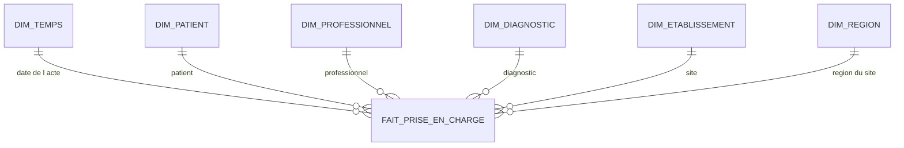
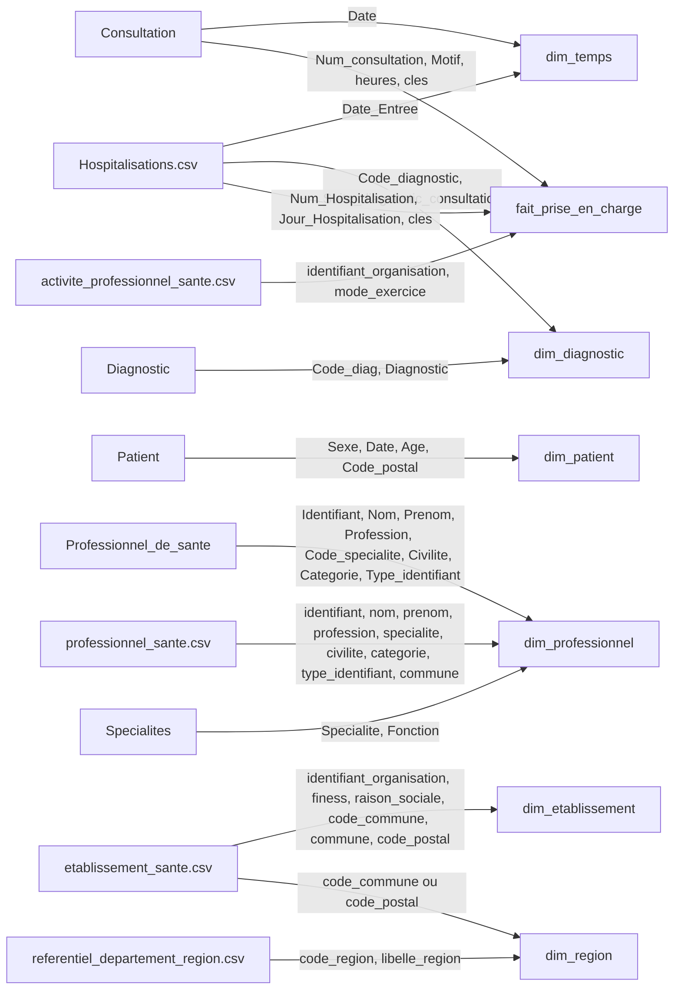
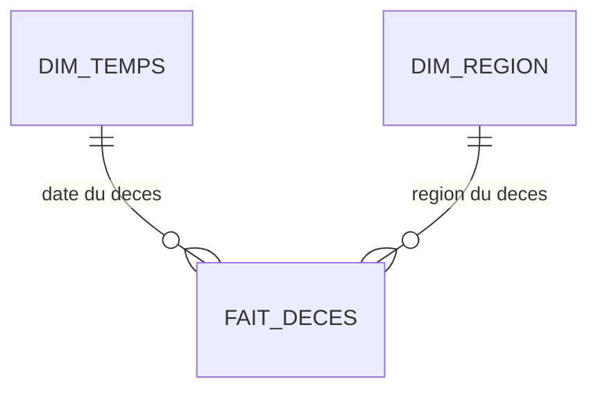
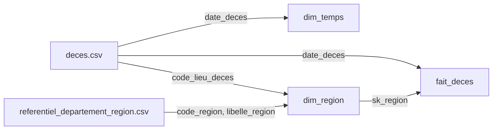
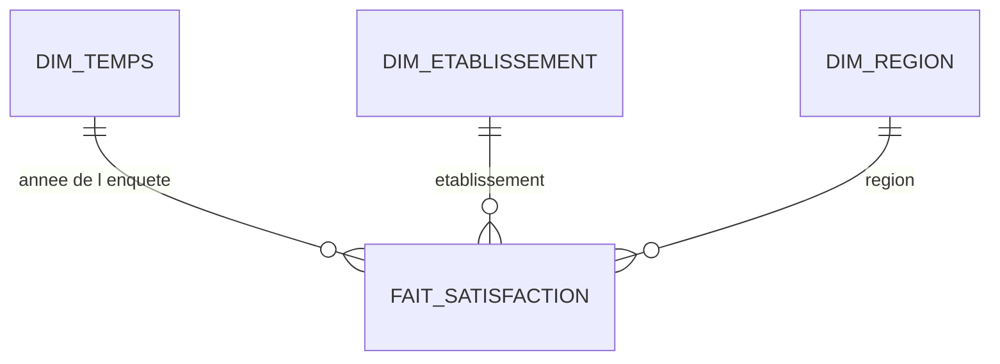
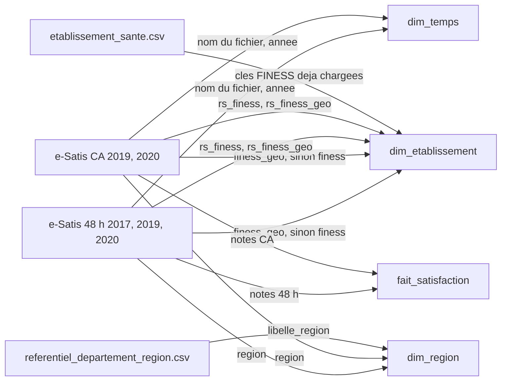

# MCD — trois étoiles

Trois étoiles. Chacune a une seule table de faits. Les dimensions sont partagées, et aucune ne pointe vers une autre. Le membre inconnu a la clé `-1`.

| Étoile | Fait | Grain |
|---|---|---|
| Prises en charge | `fait_prise_en_charge` | un acte, consultation ou séjour |
| Décès | `fait_deces` | un décès |
| Satisfaction | `fait_satisfaction` | un établissement, une enquête, une année |

Les taux ne sont pas des colonnes. Ils se calculent à la lecture.

## Étoile des prises en charge

Le grain est un acte. `type_prise_en_charge` vaut `consultation` ou `hospitalisation`. Chaque ligne référence exactement une ligne de chacune des six dimensions.

## fait_prise_en_charge

| Attribut | Sens | Clé |
|---|---|---|
| type_prise_en_charge | `consultation` ou `hospitalisation` | |
| numero_source | `Num_consultation` ou `Num_Hospitalisation` | |
| sk_temps | date de l'acte | FK dim_temps |
| sk_patient | patient | FK dim_patient |
| sk_professionnel | professionnel ; `-1` sur un séjour | FK dim_professionnel |
| sk_diagnostic | diagnostic de l'acte | FK dim_diagnostic |
| sk_etablissement | site ; `-1` si la consultation n'a pas un seul site | FK dim_etablissement |
| sk_region | région de ce site ; `-1` si le site est inconnu | FK dim_region |
| attribution_etablissement | `unique`, `multi`, `inconnue` ou `source` | |
| mode_exercice | salarié, libéral ou bénévole ; vide sur un séjour | |
| motif | motif de consultation ; vide sur un séjour | |
| nb_consultations | 1 si consultation, 0 si séjour | |
| nb_sejours | 1 si séjour, 0 si consultation | |
| duree_minutes | durée de la consultation ; vide sur un séjour | |
| duree_sejour_jours | `Jour_Hospitalisation` ; vide sur une consultation | |

L'unicité d'un acte est le couple (`type_prise_en_charge`, `numero_source`).

## Dimensions communes

## dim_temps

Une ligne par jour. `annee`, `trimestre` et `mois` se déduisent de `date_jour`.

| Attribut | Sens | Clé |
|---|---|---|
| sk_temps | clé, forme `AAAAMMJJ` ; `-1` si la date est inconnue | PK |
| date_jour | jour calendaire | |
| annee | année civile | |
| trimestre | 1 à 4 | |
| mois | 1 à 12 | |

## dim_patient

Patient anonymisé. `Id_patient` sert à construire `sk_patient` et n'est pas publié. L'âge au moment de l'acte est `annee` du fait moins `annee_naissance`. `age_extraction` est l'entier `Age` du dump, figé au moment de la fabrication du jeu.

| Attribut | Sens | Clé |
|---|---|---|
| sk_patient | clé technique ; `-1` si le patient est inconnu | PK |
| sexe | sexe | |
| annee_naissance | année extraite de `Patient.Date` | |
| age_extraction | âge enregistré dans le dump | |
| code_postal | code postal de résidence | |

## dim_professionnel

Un professionnel. La spécialité est recopiée ici. `Specialites` n'est pas une dimension.

| Attribut | Sens | Clé |
|---|---|---|
| sk_professionnel | clé technique ; `-1` si inconnu | PK |
| identifiant | identifiant normalisé | |
| nom | nom d'exercice | |
| prenom | prénom d'exercice | |
| profession | profession | |
| code_specialite | code spécialité | |
| libelle_specialite | libellé de la spécialité | |
| fonction | fonction | |
| type_identifiant | ADELI, RPPS ou autre | |
| civilite | civilité | |
| categorie_professionnelle | catégorie | |
| commune | commune d'exercice | |

## dim_diagnostic

Un code diagnostic. Les codes de la base et des séjours sont réunis.

| Attribut | Sens | Clé |
|---|---|---|
| sk_diagnostic | clé technique ; `-1` si le code est absent | PK |
| code_diagnostic | code source | |
| libelle | libellé | |

## dim_etablissement

Un site. La région n'est pas une clé de cette table : elle est sur le fait, via `dim_region`.

| Attribut | Sens | Clé |
|---|---|---|
| sk_etablissement | clé technique ; `-1` si non attribué | PK |
| identifiant_organisation | clé du site | |
| finess_juridique | FINESS juridique | |
| finess_geographique | FINESS du site | |
| raison_sociale | raison sociale | |
| code_commune | code commune INSEE | |
| commune | commune | |
| code_postal | code postal | |

## dim_region

Une région. Le libellé vient du référentiel département-région. Le département se déduit de `code_commune`, sinon de `code_postal`.

| Attribut | Sens | Clé |
|---|---|---|
| sk_region | clé technique ; `-1` si la région est inconnue | PK |
| code_region | code INSEE de la région | |
| libelle_region | libellé | |

## Flux des prises en charge

Les flèches partent de la colonne source et arrivent sur l'attribut. L'activité et le référentiel des régions ne deviennent pas des tables de l'étoile : ils servent à remplir un attribut qui existe déjà.

### Colonne source → attribut

| Provenance | Colonne | Attribut | Transformation |
|---|---|---|---|
| Consultation | Date | dim_temps.date_jour | la date choisit le jour ; annee, trimestre et mois s'en déduisent |
| Hospitalisations.csv | Date_Entree | dim_temps.date_jour | même règle, format jour/mois/année |
| Patient | Id_patient | dim_patient.sk_patient | construit la clé technique ; l'identifiant source n'est pas publié |
| Patient | Sexe | dim_patient.sexe | repris |
| Patient | Date | dim_patient.annee_naissance | année extraite du texte |
| Patient | Age | dim_patient.age_extraction | repris tel quel ; ce n'est pas l'âge à la date de l'acte |
| Patient | Code_postal | dim_patient.code_postal | repris |
| Diagnostic | Code_diag | dim_diagnostic.code_diagnostic | repris |
| Diagnostic | Diagnostic | dim_diagnostic.libelle | libellé de référence |
| Hospitalisations.csv | Code_diagnostic | dim_diagnostic.code_diagnostic | même code, autre source |
| Hospitalisations.csv | Suite_diagnostic_consultation | dim_diagnostic.libelle | libellé si la base n'en a pas |
| Professionnel_de_sante | Identifiant | dim_professionnel.identifiant | identifiant normalisé |
| professionnel_sante.csv | identifiant | dim_professionnel.identifiant | même clé, annuaire CSV |
| Professionnel_de_sante | Nom | dim_professionnel.nom | repris |
| professionnel_sante.csv | nom | dim_professionnel.nom | complète l'annuaire de la base |
| Professionnel_de_sante | Prenom | dim_professionnel.prenom | repris |
| professionnel_sante.csv | prenom | dim_professionnel.prenom | complète l'annuaire de la base |
| Professionnel_de_sante | Profession | dim_professionnel.profession | repris |
| professionnel_sante.csv | profession | dim_professionnel.profession | complète l'annuaire de la base |
| Professionnel_de_sante | Civilite | dim_professionnel.civilite | repris |
| professionnel_sante.csv | civilite | dim_professionnel.civilite | complète l'annuaire de la base |
| Professionnel_de_sante | Categorie_professionnelle | dim_professionnel.categorie_professionnelle | repris |
| professionnel_sante.csv | categorie_professionnelle | dim_professionnel.categorie_professionnelle | complète l'annuaire de la base |
| Professionnel_de_sante | Type_identifiant | dim_professionnel.type_identifiant | repris |
| professionnel_sante.csv | type_identifiant | dim_professionnel.type_identifiant | complète l'annuaire de la base |
| professionnel_sante.csv | commune | dim_professionnel.commune | absente de la base |
| Professionnel_de_sante | Code_specialite | dim_professionnel.code_specialite | repris |
| Specialites | Code_specialite | dim_professionnel.code_specialite | clé de jointure avec le professionnel ; la valeur stockée est celle de la base |
| Specialites | Specialite | dim_professionnel.libelle_specialite | recopié sur le professionnel |
| Specialites | Fonction | dim_professionnel.fonction | recopié sur le professionnel |
| professionnel_sante.csv | specialite | dim_professionnel.libelle_specialite | texte de l'annuaire si le code n'a pas de libellé |
| etablissement_sante.csv | identifiant_organisation | dim_etablissement.identifiant_organisation | clé du site |
| etablissement_sante.csv | finess_etablissement_juridique | dim_etablissement.finess_juridique | repris |
| etablissement_sante.csv | finess_site | dim_etablissement.finess_geographique | repris |
| etablissement_sante.csv | raison_sociale_site | dim_etablissement.raison_sociale | repris |
| etablissement_sante.csv | code_commune | dim_etablissement.code_commune | repris |
| etablissement_sante.csv | commune | dim_etablissement.commune | repris |
| etablissement_sante.csv | code_postal | dim_etablissement.code_postal | repris |
| referentiel_departement_region.csv | code_region | dim_region.code_region | jointure par le département du site |
| referentiel_departement_region.csv | libelle_region | dim_region.libelle_region | même jointure |
| etablissement_sante.csv | code_commune, sinon code_postal | dim_region | fournit le département de la jointure ; ne devient pas une colonne de dim_region |
| Consultation | Num_consultation | fait.numero_source | avec type_prise_en_charge = consultation |
| Consultation | Date | fait.sk_temps | clé du jour |
| Consultation | Id_patient | fait.sk_patient | clé du patient |
| Consultation | Id_prof_sante | fait.sk_professionnel | clé du professionnel |
| Consultation | Code_diag | fait.sk_diagnostic | clé du diagnostic |
| Consultation | Motif | fait.motif | repris |
| Consultation | Heure_debut, Heure_fin | fait.duree_minutes | différence des deux heures |
| Consultation | — | fait.nb_consultations | valeur fixe 1 |
| Consultation | — | fait.nb_sejours | valeur fixe 0 |
| activite_professionnel_sante.csv | identifiant, identifiant_organisation | fait.sk_etablissement | site du professionnel ; un seul site donne `unique`, plusieurs donnent `multi`, aucun donne `inconnue` |
| activite_professionnel_sante.csv | mode_exercice | fait.mode_exercice | repris sur la consultation |
| activite_professionnel_sante.csv | — | fait.sk_region | région du site retenu |
| Hospitalisations.csv | Num_Hospitalisation | fait.numero_source | avec type_prise_en_charge = hospitalisation |
| Hospitalisations.csv | Date_Entree | fait.sk_temps | clé du jour |
| Hospitalisations.csv | Id_patient | fait.sk_patient | clé du patient |
| Hospitalisations.csv | identifiant_organisation | fait.sk_etablissement | le séjour porte déjà le site ; attribution = `source` |
| Hospitalisations.csv | Code_diagnostic | fait.sk_diagnostic | clé du diagnostic |
| Hospitalisations.csv | Jour_Hospitalisation | fait.duree_sejour_jours | repris |
| Hospitalisations.csv | — | fait.sk_professionnel | `-1`, le séjour n'a pas de professionnel |
| Hospitalisations.csv | — | fait.nb_sejours | valeur fixe 1 |
| Hospitalisations.csv | — | fait.nb_consultations | valeur fixe 0 |
| Hospitalisations.csv | — | fait.sk_region | région du site du séjour |

## Étoile des décès

Le grain est un décès du fichier INSEE. Chaque ligne référence `dim_temps` et `dim_region`. Le nombre de décès par région en 2019 est le compte des lignes dont l'année est 2019.

### fait_deces

| Attribut | Sens | Clé |
|---|---|---|
| sk_deces | clé technique de la ligne | PK |
| sk_temps | date du décès | FK dim_temps |
| sk_region | région du lieu de décès ; `-1` si le code commune ne donne pas de département | FK dim_region |
| nb_deces | toujours 1 | |

| Provenance | Colonne | Attribut | Transformation |
|---|---|---|---|
| deces.csv | date_deces | dim_temps.date_jour | choisit le jour ; annee, trimestre et mois s'en déduisent |
| deces.csv | date_deces | fait_deces.sk_temps | clé de ce jour |
| deces.csv | code_lieu_deces | fait_deces.sk_region | les deux premiers caractères, ou `2A` / `2B`, donnent le département, puis la région |
| referentiel_departement_region.csv | code_region | dim_region.code_region | même référentiel que pour les sites |
| referentiel_departement_region.csv | libelle_region | dim_region.libelle_region | même référentiel |
| deces.csv | — | fait_deces.nb_deces | valeur fixe 1 |

## Étoile de la satisfaction

Le grain est un établissement, pour une enquête (`48h` ou `CA`), pour une année. Les fichiers e-Satis 2017, 2019 et 2020 sont empilés. Chaque ligne référence `dim_temps`, `dim_etablissement` et `dim_region`.

L'année n'est pas une colonne : elle est lue dans le nom du fichier et pointe vers le 1er janvier de cette année. Sur une ligne `48h`, les notes de chirurgie ambulatoire sont vides, et l'inverse. Le fichier 2017 n'a pas de recommandation : ces deux attributs y sont vides.

### fait_satisfaction

| Attribut | Sens | Clé |
|---|---|---|
| sk_temps | 1er janvier de l'année du fichier | FK dim_temps |
| sk_etablissement | site ; `-1` si aucun FINESS ne joint | FK dim_etablissement |
| sk_region | région indiquée par l'enquête | FK dim_region |
| type_enquete | `48h` ou `CA` | |
| participation | obligatoire ou facultative | |
| score_global | note globale ajustée | |
| nb_reponses | nombre de réponses de la note globale | |
| classement | classe A à D, ou effectif insuffisant | |
| evolution | changement de classe d'une année sur l'autre | |
| taux_recommandation | part des patients qui recommandent | |
| nb_recommandations | nombre de patients qui recommandent | |
| score_accueil | 48 h, accueil | |
| nb_accueil | 48 h, effectif accueil | |
| score_pec_infirmier | 48 h, prise en charge infirmiers | |
| nb_pec_infirmier | 48 h, effectif | |
| score_pec_medecin | 48 h, prise en charge médecins | |
| nb_pec_medecin | 48 h, effectif | |
| score_chambre | 48 h, chambre | |
| nb_chambre | 48 h, effectif | |
| score_repas | 48 h, repas | |
| nb_repas | 48 h, effectif | |
| score_sortie | 48 h, sortie | |
| nb_sortie | 48 h, effectif | |
| score_avant | CA, avant l'hospitalisation | |
| nb_avant | CA, effectif | |
| score_accueil_jour | CA, accueil le jour du séjour | |
| nb_accueil_jour | CA, effectif | |
| score_prise_en_charge | CA, prise en charge | |
| nb_prise_en_charge | CA, effectif | |
| score_chambre_repas | CA, chambre et repas | |
| nb_chambre_repas | CA, effectif | |
| score_sortie_domicile | CA, sortie et retour à domicile | |
| nb_sortie_domicile | CA, effectif | |

L'unicité d'une ligne est le triplet (`sk_etablissement`, `type_enquete`, `sk_temps`).

| Provenance | Colonne | Attribut | Transformation |
|---|---|---|---|
| e-Satis 48 h et CA | nom du fichier | fait_satisfaction.sk_temps | l'année du nom pointe vers le 1er janvier ; `type_enquete` vaut `48h` ou `CA` |
| e-Satis 48 h et CA | finess_geo | fait_satisfaction.sk_etablissement | jointure sur `dim_etablissement.finess_geographique` |
| e-Satis 48 h et CA | finess | fait_satisfaction.sk_etablissement | repli sur `finess_juridique` si le site géographique ne joint pas |
| e-Satis 48 h et CA | rs_finess_geo | dim_etablissement.raison_sociale | libellé du site seulement s'il manque dans le référentiel établissements |
| e-Satis 48 h et CA | rs_finess | dim_etablissement.raison_sociale | même repli, au niveau juridique |
| e-Satis 48 h et CA | region | fait_satisfaction.sk_region | libellé aligné sur `dim_region.libelle_region` |
| e-Satis 48 h et CA | participation | fait_satisfaction.participation | repris |
| e-Satis 48 h | score_all_rea_ajust | fait_satisfaction.score_global | note globale |
| e-Satis CA | score_all_ajust | fait_satisfaction.score_global | même mesure, autre enquête |
| e-Satis 48 h | nb_rep_score_all_rea_ajust | fait_satisfaction.nb_reponses | poids de l'agrégat régional |
| e-Satis CA | nb_rep_score_all_ajust | fait_satisfaction.nb_reponses | même poids, autre enquête |
| e-Satis 48 h et CA | classement | fait_satisfaction.classement | repris |
| e-Satis 48 h et CA | evolution | fait_satisfaction.evolution | repris |
| e-Satis 48 h 2019 et 2020, et CA | taux_reco_brut | fait_satisfaction.taux_recommandation | absent du fichier 2017 |
| e-Satis 48 h 2019 et 2020, et CA | nb_reco_brut | fait_satisfaction.nb_recommandations | absent du fichier 2017 |
| e-Satis 48 h | score_accueil_rea_ajust | fait_satisfaction.score_accueil | repris |
| e-Satis 48 h | nb_rep_score_accueil_rea_ajust | fait_satisfaction.nb_accueil | repris |
| e-Satis 48 h | score_PECinf_rea_ajust | fait_satisfaction.score_pec_infirmier | repris |
| e-Satis 48 h | nb_rep_score_PECinf_rea_ajust | fait_satisfaction.nb_pec_infirmier | repris |
| e-Satis 48 h | score_PECmed_rea_ajust | fait_satisfaction.score_pec_medecin | repris |
| e-Satis 48 h | nb_rep_score_PECmed_rea_ajust | fait_satisfaction.nb_pec_medecin | repris |
| e-Satis 48 h | score_chambre_rea_ajust | fait_satisfaction.score_chambre | repris |
| e-Satis 48 h | nb_rep_score_chambre_rea_ajust | fait_satisfaction.nb_chambre | repris |
| e-Satis 48 h | score_repas_rea_ajust | fait_satisfaction.score_repas | repris |
| e-Satis 48 h | nb_rep_score_repas_rea_ajust | fait_satisfaction.nb_repas | repris |
| e-Satis 48 h | score_sortie_rea_ajust | fait_satisfaction.score_sortie | repris |
| e-Satis 48 h | nb_rep_score_sortie_rea_ajust | fait_satisfaction.nb_sortie | repris |
| e-Satis CA | score_AVH_ajust | fait_satisfaction.score_avant | repris |
| e-Satis CA | nb_rep_score_AVH_ajust | fait_satisfaction.nb_avant | repris |
| e-Satis CA | score_ACC_ajust | fait_satisfaction.score_accueil_jour | repris |
| e-Satis CA | nb_rep_score_ACC_ajust | fait_satisfaction.nb_accueil_jour | repris |
| e-Satis CA | score_PEC_ajust | fait_satisfaction.score_prise_en_charge | repris |
| e-Satis CA | nb_rep_score_PEC_ajust | fait_satisfaction.nb_prise_en_charge | repris |
| e-Satis CA | score_CER_ajust | fait_satisfaction.score_chambre_repas | repris |
| e-Satis CA | nb_rep_score_CER_ajust | fait_satisfaction.nb_chambre_repas | repris |
| e-Satis CA | score_OVS_ajust | fait_satisfaction.score_sortie_domicile | repris |
| e-Satis CA | nb_rep_score_OVS_ajust | fait_satisfaction.nb_sortie_domicile | repris |
