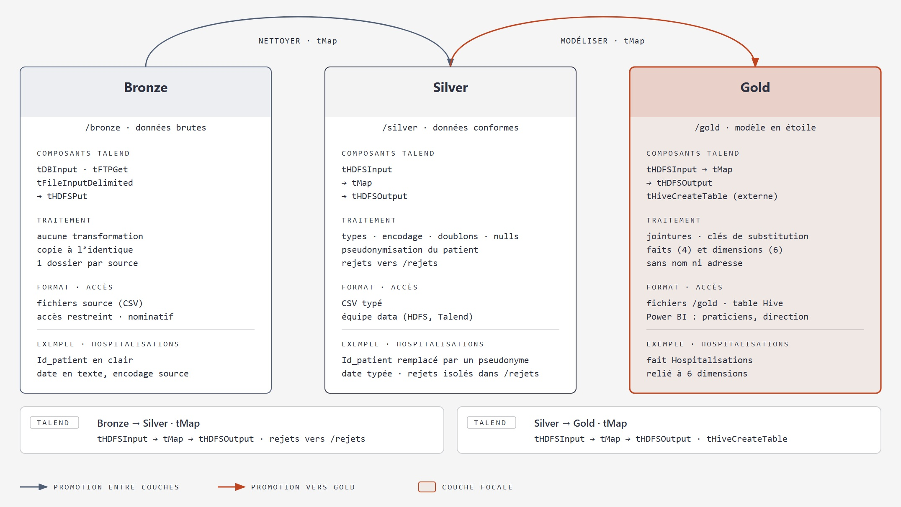

# BigData — Entrepôt de données décisionnel pour le secteur hospitalier

Projet **Cloud Healthcare Unit** — Bloc Stockage et BigData, PGE A4 FISA / A3 FISE Big Data 26-27 (CESI).

Ce dépôt rassemble les travaux de l'équipe : l'architecture cible, la modélisation de l'entrepôt, puis l'implémentation et l'exploitation des données.

## Contexte

Le groupe hospitalier fictif **CHU** engage une transformation digitale de son système d'information. Ses systèmes de gestion des soins et des fichiers de données publics produisent un volume considérable d'informations qui restent inexploitées. Les praticiens et les directions d'établissement n'y ont pas accès sous une forme directement utilisable.

Notre équipe est missionnée pour **concevoir et implémenter un entrepôt de données décisionnel (EDD)**. Il doit intégrer des données hétérogènes dans une source unique, cohérente et gouvernée, puis les rendre explorables et visualisables.

Les données de santé étant sensibles, la solution doit respecter des exigences réglementaires et techniques :

- **Sécurité et conformité :** RGPD, hébergement de données de santé (HDS), CNIL.
- **Coût-efficacité** de l'infrastructure.
- **Élasticité et scalabilité.**

## Objectif

Fournir une plateforme analytique unifiée qui répond à deux profils d'utilisateurs, les **praticiens** et la **direction d'établissement**, sur les axes suivants : suivi des patients, activité hospitalière, mortalité et satisfaction des usagers, à l'échelle nationale et sur le long terme.

Analyses attendues :

- Taux de consultation dans un établissement donné, sur une période donnée.
- Taux de consultation par diagnostic, sur une période donnée.
- Taux global d'hospitalisation sur une période donnée.
- Taux d'hospitalisation par diagnostic.
- Taux d'hospitalisation par sexe et par âge.
- Taux de consultation par professionnel.
- Nombre de décès par région sur l'année 2019 (optionnel).
- Taux global de satisfaction par région sur l'année 2020 (optionnel).

## Sources de données

| # | Source | Contenu | Accès |
|---|---|---|---|
| 1 | Base PostgreSQL opérationnelle | Actes médico-administratifs : patients, consultations, diagnostics, professionnels | JDBC |
| 2 | Fichiers CSV | Référentiel des établissements (FINESS/INSEE), hospitalisations, professionnels | Fichiers |
| 3 | Fichiers plats | Notes de satisfaction des patients (format CSV ou JSON à confirmer) | FTP |
| 4 | Fichiers plats | Répertoire national des décès, INSEE (open data, environ 25 millions de lignes) | FTP |

## Architecture globale

Les données suivent un parcours de bout en bout : **sources → ETL → stockage en trois couches → BI**.

| Étape | Technologie | Rôle |
|---|---|---|
| ETL | Talend Open Studio for Big Data 7.3.1 (JDK 8) | Extraction des quatre sources, nettoyage, pseudonymisation, isolement des rejets, chargement |
| Stockage | HDFS + Hive 1.1 sur Cloudera QuickStart (CDH 5) | Data lake en trois couches, couche SQL Hive sur Silver et Gold |
| Restitution | Power BI Desktop | Tableaux de bord, connexion ODBC à HiveServer2, lecture de la couche Gold |

PostgreSQL est une source de l'architecture, jamais la cible.

### Les trois couches : Bronze, Silver, Gold

Les données montent en qualité par étapes, sans jamais écraser les fichiers d'origine.

| Couche | Contenu | Accès |
|---|---|---|
| **Bronze** | Fichiers sources tels que reçus, un dossier par source | Restreint (données nominatives) |
| **Silver** | Données nettoyées et typées, doublons et valeurs nulles traités, patient pseudonymisé | Équipe data, Talend |
| **Gold** | Modèle en étoile, prêt pour l'analyse | Power BI : praticiens et direction |

Pourquoi trois couches :

- **Rejouabilité :** une règle de nettoyage erronée se corrige en rejouant Silver depuis Bronze, sans retourner chercher les fichiers à la source.
- **Traçabilité :** chaque indicateur de Gold se remonte jusqu'au fichier d'origine, et les lignes rejetées sont isolées dans un dossier dédié.
- **RGPD :** seule la couche Bronze contient des identifiants en clair, d'où son accès restreint.

## Modèle de données (couche Gold)

Le modèle est une **constellation de faits** : deux tables de faits qui partagent les mêmes dimensions.

- **Faits :** `fait_consultation` et `fait_hospitalisation`.
- **Dimensions :** `dim_temps`, `dim_patient` (pseudonymisé, sans nom ni adresse), `dim_diagnostic`, `dim_professionnel`, `dim_etablissement`.
- **Table de pont :** `pont_prof_etab` rattache une consultation à un établissement par le professionnel. Elle est pondérée (poids = 1 ÷ nombre d'établissements du professionnel) pour que les comptages restent justes.
- Les taux sont calculés dans Power BI : nombre d'événements ÷ nombre de patients distincts du même filtre.

## Gouvernance et conformité

Mesures prévues, d'après la fiche CNIL « RGPD : établissements de santé » :

- **Minimiser et pseudonymiser :** noms et adresses exclus de Gold, pseudonymisation du patient en Silver, clé conservée hors cluster.
- **Sécuriser l'accès :** Bronze à accès restreint, rôles praticien et direction, journal d'audit des flux et des accès, hébergeur certifié HDS lié par contrat (article 28).
- **Respecter les droits :** durée de conservation fixée par couche, effacement d'un patient par son pseudonyme, registre des traitements, analyse d'impact (AIPD), DPO désigné, signalement des incidents à la CNIL.

## Phases du projet

| Phase | Contenu | Statut |
|---|---|---|
| 1. Cadrage et architecture | Analyse des sources, architecture Bronze/Silver/Gold, stack technique, RGPD/HDS, gouvernance | En cours |
| 2. Modélisation | Modèle dimensionnel, tables de faits et dimensions, spécification des jobs ETL | En cours |
| 3. Implémentation physique | Création des tables, chargement, partitionnement, indexation, tests de qualité | À venir |
| 4. Exploitation et visualisation | Optimisation, benchmarks avant/après, tableau de bord et storytelling | À venir |

Points encore ouverts : format et fréquence de la source Satisfaction, modélisation des faits Décès et Satisfaction et de la dimension Région INSEE, estimation des coûts.

## Organisation du dépôt

Chaque membre de l'équipe dispose de son dossier.

| Dossier | Contenu |
|---|---|
| `Christopher/Architecture/` | Schémas de l'architecture globale |
| `Christopher/ETL/` | Architecture cible et couches Bronze/Silver/Gold (JPEG et PDF) |
| `Christopher/MLD - Conception/` | Schéma de la base décisionnelle (constellation de faits) |
| `Gael/`, `Mathis/`, `Thomas/` | Travaux des autres membres |
