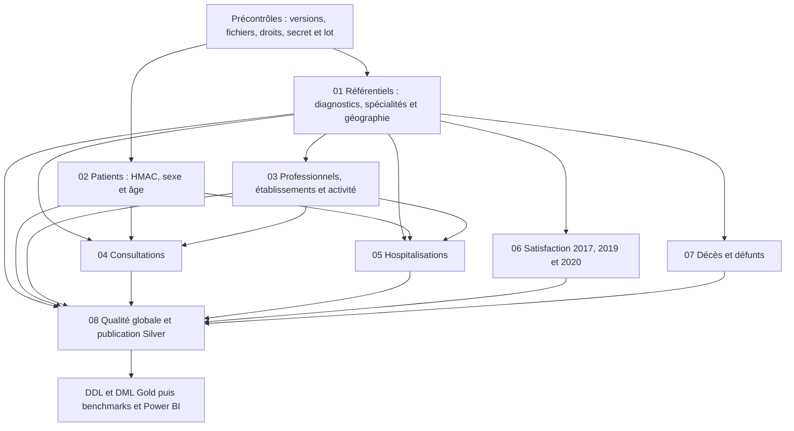

# Plan des transformations Silver

Conception du 5 novembre 2026. Les noms de scripts désignent des traitements à implémenter. Les sorties sont détaillées dans [les contrats](CONTRATS_ENTREES_SORTIES.md).

## 1. Partir du résultat attendu

Le modèle rendu contient **quatre faits, dix dimensions et un pont**, répartis en trois groupes : soins (consultations et hospitalisations), décès, satisfaction. Silver prépare ces groupes sans les agréger ni fusionner leurs grains.

| Besoin du sujet | Données à préserver dans Silver | Règle à respecter jusqu'à Gold/BI |
|---|---|---|
| Consultations dans un établissement X sur une période Y | Consultation, professionnel, activité professionnel–établissement, établissement, date et patient pseudonymisé | L'établissement n'est pas dans la consultation source. Passer par le pont, avec une allocation `1 / nombre de sites` ; ne pas multiplier les faits. |
| Consultations pour un diagnostic X sur une période Y | Consultation, diagnostic, date et patient pseudonymisé | Une ligne par consultation ; compter événements et patients distincts sous les mêmes filtres. |
| Hospitalisations globales sur Y | Hospitalisation, date d'entrée et patient pseudonymisé | Une ligne par hospitalisation ; aucune jointure avec l'activité des professionnels. |
| Hospitalisations par diagnostic sur Y | Hospitalisation, diagnostic, date et patient pseudonymisé | Même clé diagnostic que pour les consultations. |
| Hospitalisations par sexe et âge | Hospitalisation et patient pseudonymisé avec `sexe`, `age` | Ne pas recalculer un âge à l'événement à partir d'une date dont le sens est inconnu. |
| Consultations par professionnel | Consultation et professionnel, date et patient pseudonymisé | Même normalisation de l'identifiant dans la référence, les faits et le pont. |
| Décès par région en 2019 | Date de décès, code commune, département, région INSEE, une occurrence par décès | Pas de lien nominatif avec Patient. Conserver les décès dont le lieu reste inconnu. |
| Satisfaction par région en 2020 | Campagne, site FINESS, région, score global ajusté, nombre de répondants | Garder le grain site–année ; moyenne pondérée sur les lignes avec score présent et poids valide. |

Le livrable 1 définit les « taux » de soins comme `nombre d'événements / nombre de patients distincts du même filtre`. Ce ratio n'est pas une proportion de la population générale et peut dépasser 1. L'intitulé et le dénominateur devront être indiqués dans la restitution. Pour le taux par établissement, les consultations sont réparties par le pont ; le nombre de patients distincts n'est pas additionnable entre établissements. Le choix de cette allocation est une estimation prévue par le rendu, pas la preuve du lieu réel de chaque consultation.

## 2. Dépendances d'exécution

Ce graphe indique les dépendances, pas une obligation de lancer toutes les branches simultanément. Sur une VM, le traitement des 25 millions de décès peut occuper les ressources à lui seul. Toutes les sorties d'un même cycle doivent référencer le même manifeste Bronze et les mêmes versions de règles. Les vérifications FINESS entre satisfaction et établissements se font au contrôle global et ne doivent pas devenir un filtre supprimant la satisfaction.

## 3. Règles communes

- Lire chaque fichier avec son propre schéma, son encodage et son séparateur ; contrôler les en-têtes et le nombre de colonnes. Les cinq exports PostgreSQL n'ont pas d'en-tête.
- Lire initialement les valeurs à risque comme chaînes, puis effectuer les conversions contrôlées. Une conversion ratée doit être comptée, avec une règle explicite de rejet ou de maintien à `NULL`.
- Retirer BOM et espaces périphériques des noms de colonnes/codes lorsque justifié ; ne pas modifier arbitrairement le contenu des libellés.
- Conserver en texte FINESS, codes postaux, codes commune, département, région et identifiants professionnels. Préserver les zéros et les lettres `2A`/`2B`.
- Pour chaque clé supposée unique : retirer les répétitions identiques justifiées, puis détecter les valeurs contradictoires. Sans priorité métier fiable, isoler **toutes** les lignes du groupe contradictoire ; ne pas choisir la « première ligne » d'une partition Spark.
- Conserver une provenance technique sans données nominatives : `lot_id`, `source_id`, `source_record_id`, `version_regles`, ainsi que les indicateurs qualité utiles. Les tables Silver présentées ci-dessous décrivent les colonnes métier ; les métadonnées peuvent être conservées à côté.
- Les listes d'opposition/exclusion prévues par le plan de gouvernance s'appliquent à Patient, Consultation et Hospitalisations de manière cohérente. Compter ces exclusions séparément des erreurs de données.
- Ne pas limiter les sources aux années 2019/2020 : ces années sont des filtres d'analyse. Conserver l'historique chargé et les campagnes 2017/2019/2020 retenues.

## 4. `01_referentiels.py`

### Diagnostic et spécialités

1. Lire les deux exports PostgreSQL avec l'ordre de colonnes contractuel.
2. Normaliser les espaces des clés, préserver les codes en texte.
3. Renommer `Diagnostic` en `libelle`, `Specialite` en `specialite`.
4. Contrôler les clés obligatoires, les répétitions identiques et les conflits de libellé pour une même clé.
5. Publier `diagnostic` et `specialite`. Une spécialité non renseignée chez un professionnel n'entraîne pas le rejet de celui-ci : le script `03` produira le libellé `inconnu` et une anomalie mesurée.

### Codes postaux

1. Décoder Windows-1252 ; retirer `#` du premier nom de colonne.
2. Harmoniser les noms en `code_commune_insee`, `nom_de_la_commune`, `code_postal`, `libelle_d_acheminement`.
3. Ne pas reprendre `Ligne_5`, comme prévu dans le rendu.
4. Pour chaque commune, sélectionner le **plus petit code postal valide**. Les codes sont comparables une fois validés sur cinq caractères. Si plusieurs lignes portent ce code, sélectionner par ordre explicite des libellés normalisés, puis par provenance stable.
5. Isoler les autres lignes sous le motif `ALTERNATIVE_POSTALE_NON_RETENUE`. Elles peuvent être valides : c'est un choix de réduction au grain commune, pas une erreur de la source.
6. Sortie `codes_postaux` : une ligne par commune. Ne pas utiliser cette table réduite pour prétendre représenter tous les codes postaux d'une commune.

### Communes et régions

1. Lire séparément le COG communes 2024 et le COG régions 2024.
2. Contrôler `TYPECOM`, `COM`, `COMPARENT`, `REG`, `DEP` et les libellés. Ne pas filtrer simplement `TYPECOM = COM` en perdant les arrondissements et communes associées/déléguées utiles aux rapprochements.
3. Construire une correspondance univoque par code commune : utiliser les données directes lorsqu'elles existent ; pour ARM/COMA/COMD, résoudre le parent lorsqu'il est nécessaire. Détecter les parents absents, les cycles et les correspondances ambiguës.
4. Joindre `REG` au référentiel régions. Produire `code_departement`, `code_region`, `libelle_region`, avec le type de commune et la provenance du rattachement.
5. Mettre à disposition une ligne de région `inconnu` et une table explicite de correspondance des variantes e-Satis vers les libellés/codes retenus. Ne pas faire de rapprochement approximatif silencieux.
6. Conserver la version des références. Le COG 2024 et l'extrait postal téléchargé en 2026 ne reconstituent pas à eux seuls la géographie de chaque année historique.

Les codes historiques non reconnus restent présents dans les données de décès, avec un rattachement non résolu. Un complément historique pourra améliorer leur couverture ; il n'est pas déjà chargé.

## 5. `02_patients.py`

1. Lire Patient (16 colonnes), mais ne retenir pour la sortie que `Id_patient`, `Sexe`, `Age`.
2. Vérifier l'identifiant patient avant HMAC. La source PostgreSQL est entière : définir une représentation décimale canonique commune aux trois sources. Refuser une valeur illisible, fractionnaire ou ambiguë au lieu de la transformer silencieusement.
3. Appliquer les éventuelles exclusions autorisées, puis calculer le **HMAC-SHA256 complet** sur cet identifiant normalisé. Sortie hexadécimale de 64 caractères dans `id_patient STRING`.
4. Utiliser la même clé secrète stable, le même espace d'identité, la même normalisation et le même encodage pour Patient, Consultation et Hospitalisations. Ne pas utiliser SHA-256 simple, un secret concaténé ou une clé par table.
5. Normaliser les valeurs connues de sexe vers `M`/`F` ; une valeur absente/non reconnue devient `inconnu`, avec un compteur. Ne pas inventer de sexe.
6. Convertir `Age` en entier ; une valeur absente ou non numérique devient `NULL`, avec un compteur. Les bornes métier de plausibilité seront configurées et documentées, sans supprimer une personne sur une borne arbitraire.
7. Contrôler l'unicité avant et après pseudonymisation. Les conflits d'identifiant et une éventuelle collision HMAC bloquent la publication de la référence.
8. Sortie : `patient(id_patient, sexe, age)`.

Ne publier ni nom, prénom, adresse, ville, courriel, téléphone, numéro de sécurité sociale, ni identifiant patient source. Code postal patient, pays, groupe sanguin, poids et taille ne sont pas nécessaires aux indicateurs retenus. `Patient.Date` n'est pas interprétée comme une date de naissance : son sens n'est pas établi. L'âge source décrit l'état fourni, pas un âge recalculé à chaque consultation.

Le secret reste hors Git, fichiers de données et journaux. Son accès par le driver et les exécuteurs doit être conçu et testé sur la VM ; son absence provoque un arrêt, jamais un pseudonyme de remplacement. Les sorties restent des données pseudonymisées, pas une anonymisation garantie.

## 6. `03_professionnels_etablissements.py`

### Professionnels

1. Lire `Professionnel_de_sante`, retirer nom et prénom de la sortie, conserver l'identifiant en texte.
2. À partir de `Type_identifiant`, compléter un ADELI numérique de huit caractères à neuf caractères. Préserver un ADELI déjà correct et les identifiants RPPS à onze caractères. Ne pas appliquer un remplissage uniforme à tous les identifiants.
3. Construire une correspondance contrôlée entre identifiants sources et normalisés. La réutiliser pour les consultations et les activités ; vérifier qu'aucune normalisation ne fusionne deux professionnels distincts.
4. Renommer `Identifiant` en `id_prof_sante`, `Categorie_professionnelle` en `categorie`, `Profession` en `profession`.
5. Joindre les spécialités par `Code_specialite` ; libellé absent/non trouvé → `inconnu`, anomalie comptée.
6. Contrôler la clé et produire `professionnel`. Civilité et noms ne sont pas nécessaires à Gold.

### Établissements

1. Lire les 24 colonnes du fichier et les conserver en Silver conformément au rendu ; Gold n'en prendra qu'un sous-ensemble. L'accès à cette table reste adapté à son contenu.
2. Normaliser `identifiant_organisation`, les codes FINESS et géographiques en texte. Contrôler le préfixe et le domaine de chaque identifiant sans supposer que toutes les organisations sont des sites FINESS.
3. Ne pas rejeter un établissement parce que `finess_site` est vide : la clé métier retenue est `identifiant_organisation` et le fichier a une forte absence de FINESS site.
4. Contrôler les références géographiques par jointure gauche, conserver la ligne si le rattachement est absent et signaler l'écart. Ne pas remplacer le code postal déclaré par le plus petit code postal de la commune.
5. Résoudre les répétitions de clé. Le rendu indique à un endroit 16 clés en double et à un autre l'unicité : mesurer le lot réel ; les conflits restent en quarantaine en attente d'une règle de priorité.
6. Produire `etablissement`, une ligne par organisation acceptée. La ligne technique d'établissement `inconnu` sera ajoutée à la dimension Gold.

### Activité professionnel–établissement

1. Lire les trois colonnes, renommer `identifiant` en `id_prof_sante` et appliquer la correspondance professionnelle.
2. `mode_exercice` vide → `inconnu` ; organisation vide → rejet de la relation avec motif explicite.
3. Vérifier l'existence du professionnel et de l'établissement. Une relation orpheline est isolée ; elle ne supprime ni le professionnel ni ses consultations.
4. Retirer les répétitions exactes ; contrôler le couple professionnel–organisation. Si plusieurs modes contradictoires existent, ne pas choisir `MAX(mode_exercice)` comme règle métier : isoler le conflit jusqu'à résolution.
5. Produire `activite` au grain couple professionnel–organisation, sans réduire les professionnels multisites à un seul site.

Gold construira le pont avec ces relations valides et rattachera à `inconnu` les professionnels sans relation valide. S'il reste au moins une relation valide pour un professionnel, le pont ne lui ajoute pas automatiquement une part `inconnu` pour chaque activité rejetée. La pondération `1 / nombre de sites valides` est appliquée au calcul prévu dans le rendu ; sa somme doit valoir 1 pour chaque professionnel, y compris celui rattaché uniquement à `inconnu`.

## 7. `04_consultations.py`

1. Lire les neuf colonnes de l'export, restaurer les champs vides à `NULL` selon le contrat de ce lot.
2. Retenir `Num_consultation`, `Id_patient`, `Id_prof_sante`, `Code_diag`, `Date` ; renommer en noms Silver.
3. Typer la date de consultation, normaliser diagnostic et professionnel avec les mêmes règles que les références.
4. Appliquer exclusions et HMAC patient avec la fonction commune.
5. Contrôler identifiant de consultation, date et références Patient/Diagnostic/Professionnel. Les références absentes produisent un rejet explicite ; une jointure interne ne doit pas faire disparaître les lignes sans compteur.
6. Retirer les répétitions exactement identiques justifiées ; une même clé avec des valeurs différentes est un conflit, pas une ligne à choisir arbitrairement.
7. Produire `consultation` : une ligne par consultation acceptée.

Ne pas joindre le pont à ce stade : cela multiplierait les consultations multisites. `Id_mut`, le texte libre `Motif` et les heures ne sont pas repris dans la table métier minimale car les besoins retenus ne les utilisent pas. Les heures et leur typage pourront être ajoutés si un indicateur validé le nécessite ; ils ne doivent pas devenir une cause de rejet d'une consultation autrement exploitable. Le retrait de ces colonnes est une projection documentée, pas la perte d'une ligne.

## 8. `05_hospitalisations.py`

1. Lire les sept colonnes du CSV.
2. Renommer `Num_Hospitalisation` en `num_hospitalisation`, `Date_Entree` en `date_entree`, `Code_diagnostic` en `code_diag`.
3. Valider le format réel de la date puis la convertir strictement, sans faire passer une date invalide pour une date corrigée.
4. Normaliser `Id_patient`, appliquer les exclusions puis le même HMAC que pour les deux autres sources.
5. Conserver l'identifiant d'organisation en texte ; vérifier Patient, Diagnostic et Établissement.
6. Contrôler clé, répétitions identiques et conflits ; isoler les références absentes et les dates invalides.
7. Produire `hospitalisation` : une ligne par séjour accepté.

Ne pas ajouter de professionnel : il n'existe pas dans cette source. `Suite_diagnostic_consultation` et `Jour_Hospitalisation` restent dans Bronze ; les conserver en colonne auxiliaire Silver seulement si leur usage et leur sens sont validés. En particulier, ne pas calculer de date de sortie ou de durée sur l'hypothèse que `Jour_Hospitalisation` signifie une durée.

## 9. `06_satisfaction.py`

1. Lire uniquement **e-Satis 48 h MCO** des campagnes 2017, 2019 et 2020. Les données de chirurgie ambulatoire, les autres IQSS et les lexiques ne deviennent pas des faits de satisfaction de ce périmètre.
2. Décoder les CSV 2017/2019 en Windows-1252. Pour 2020, lire la feuille `Resultats` du XLSX avec un lecteur compatible ou une conversion contrôlée dans un espace de préparation séparé ; garder le XLSX Bronze intact.
3. Récupérer les colonnes communes nécessaires et ajouter `annee` à partir du manifeste du fichier, pas de la date de chargement. Contrôler explicitement l'association fichier–campagne.
4. Lire `finess_geo` en texte, restaurer les zéros initiaux selon la longueur attendue de neuf chiffres après validation. Dans un classeur, une valeur numérique entière peut avoir perdu sa présentation : la conversion ne doit pas produire `12345678.0` ou une notation scientifique.
5. Construire `identifiant_organisation = 'F' + finess_geo`. Ne pas utiliser `finess` juridique comme clé du site.
6. Normaliser la région par correspondance explicite ; conserver le libellé source en provenance pour le diagnostic. Région vide → `inconnu` ; libellé non reconnu → rattachement non résolu et anomalie, pas suppression de la ligne.
7. Convertir `score_all_rea_ajust` en nombre et `nb_rep_score_all_rea_ajust` en entier, avec séparateur décimal explicitement traité. Score vide/non diffusé → `NULL`, jamais zéro. Distinguer dans les métriques une valeur manquante d'une valeur non vide non convertible.
8. Contrôler les domaines (score sur l'échelle documentée du fichier, nombre de répondants entier non négatif), la cohérence score/poids et la clé `(finess_geo, annee)`. Une valeur non vide non convertible ou hors domaine produit un rejet de mesure explicite. Un score absent est autorisé et conserve la ligne ; un score présent avec un poids absent ou nul conserve aussi la ligne avec un indicateur `POIDS_NON_EXPLOITABLE`, mais cette ligne sera exclue de la moyenne pondérée. Ne pas inventer un score ou un nombre de répondants.
9. Retirer seulement les répétitions identiques ; isoler les conflits site–année. FINESS géographique absent/invalide ou campagne non reconnue → rejet.
10. Produire `satisfaction`, puis comparer FINESS/organisations à la référence établissements au contrôle global, sans imposer la présence dans cette référence comme condition d'acceptation du fait satisfaction.

Les deux colonnes de recommandation absentes en 2017 ne sont pas utilisées : leur absence est tolérée explicitement. Garder séparés les nombres de réponses et les scores ; ne pas additionner les scores. Le futur score régional 2020 sera `somme(score × nb_reponses) / somme(nb_reponses)` sur **le même ensemble de lignes** ayant score non NULL et poids strictement positif ; si le dénominateur est nul, résultat `NULL`. Il s'agit de l'agrégation des scores ajustés prévue par le rendu, pas d'un pourcentage de patients satisfaits reconstitué individuellement.

## 10. `07_deces.py`

1. Lire les 25 millions de lignes de façon distribuée, en respectant le CSV et ses éventuels champs entre guillemets. Aucun chargement intégral dans pandas, `collect()` ou boucle sur le driver.
2. Attribuer une provenance stable à chaque **occurrence source** avant de retirer des colonnes. Une identité basée uniquement sur les valeurs restantes fusionnerait des événements distincts.
3. Retirer `nom` et `prenom` des sorties Silver et des journaux/rejets ordinaires.
4. Valider strictement les dates puis les typer. Le format exact est fixé après inspection technique de la source ; aucune conversion implicite dépendante du poste.
5. Date de décès absente/invalide → rejet. Date de naissance absente/invalide → `NULL`, ligne conservée avec indicateur. Naissance valide postérieure au décès → rejet. Numéro d'acte absent → `NULL`.
6. Sexe `1`/`2` → `M`/`F` ; autre valeur → `inconnu` et anomalie mesurée.
7. Nettoyer `code_lieu_deces` et produire `code_commune_deces` ; valeur vide → `inconnu`. Conserver les codes de naissance en texte.
8. Faire une jointure gauche vers la correspondance COG univoque : commune → département → région. Si elle échoue, conserver le décès, ses codes et le statut du rapprochement. Pour le département dérivé du code, appliquer les cas documentés `97x`, `2A`/`2B`, `99` ; ne pas inventer une région par les deux premiers caractères.
9. Générer `deces_key` et `defunt_key` stables et uniques par occurrence acceptée. Le numéro d'acte n'est pas une clé et aucun rapprochement d'identité avec Patient n'est prévu.
10. Produire `deces` et `defunt`, sans dédoublonnage nominal et sans dédoublonnage sur les colonnes restantes après retrait des noms.

**Gestion des clés :** conserver un registre technique persistant qui associe l'occurrence source à ses deux clés. Pour un fichier immuable, l'occurrence peut être repérée par empreinte du fichier + position d'enregistrement déterministe, si le lecteur sait la produire en respectant le CSV. Cette capacité doit être vérifiée, notamment pour des enregistrements multilignes. Ne pas remplacer ce registre par `monotonically_increasing_id`, un UUID régénéré ou le hash des seules valeurs métier. Une relance du même lot doit rendre les mêmes clés et conserver les occurrences identiques distinctes. Les clés `INT` du modèle doivent être contrôlées contre la capacité du registre ; tout passage à `BIGINT` sera une évolution explicite du DDL. Le mécanisme concret sera testé avant exécution complète.

Les homonymes sont conservés : le rendu indique qu'ils ne se distinguent pas de vrais doublons. Le commentaire général sur le dédoublonnage ne justifie donc pas un `dropDuplicates()` global sur les décès.

Gold fabriquera une ligne de lieu par code de décès observé, même absent du référentiel postal. Les libellés et le code postal peuvent rester NULL ; les décès ne doivent pas disparaître à cause d'un changement de commune historique ou d'une absence de code postal. `code_region` et `libelle_region` doivent être propagés jusqu'au lieu Gold pour permettre la demande régionale 2019, évolution documentée du modèle rendu.

## 11. `08_qualite_publication.py`

Ce traitement consolide les contrôles produits par chaque script : présence des tables, schémas, clés, références, FINESS, complétude, conservation des lignes, protection et lecture réelle Hive. Il ne transforme pas un lot en succès parce qu'un processus Spark retourne simplement un code 0.

Écrire d'abord dans un lot de travail, conserver l'ancien lot publié, puis publier seulement quand les contrôles sont satisfaits. Les détails sont dans [QUALITE_ET_PUBLICATION.md](QUALITE_ET_PUBLICATION.md).

## 12. Fréquences et reprises

Fréquences prévues au rendu : PostgreSQL quotidien, CSV santé et décès mensuels, satisfaction annuelle. Le COG suit son millésime et la référence postale sa version acquise. Pour la maquette, commencer par un lot initial complet ; les scripts sont rejouables depuis ce Bronze.

Une relance ne doit ni réimporter silencieusement deux fois les événements, ni changer les HMAC/les clés décès, ni mélanger les références de deux lots. Un delta ou des mises à jour historiques demanderont une stratégie explicite supplémentaire ; ce plan ne prétend pas disposer déjà d'une CDC ou d'un historique d'activité des professionnels.
